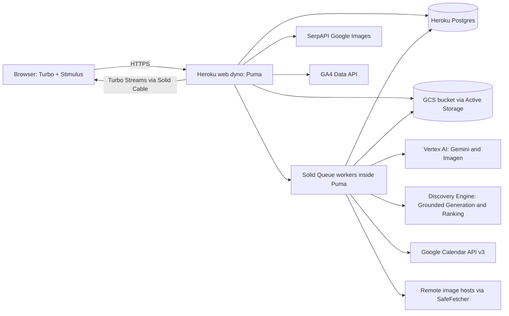
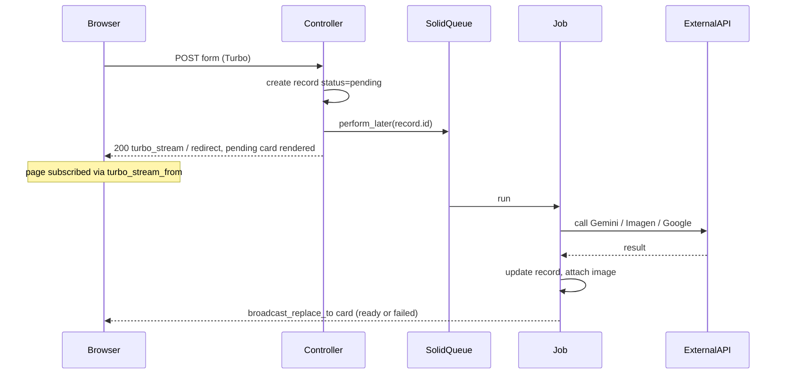
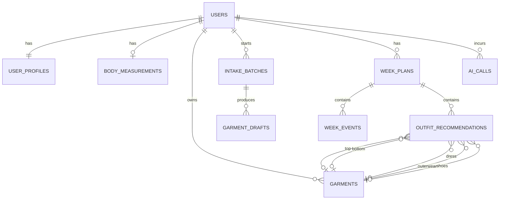
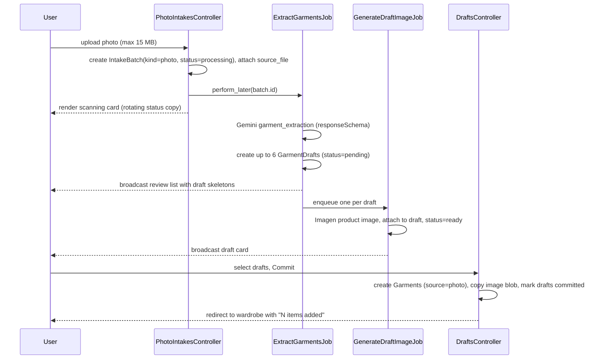
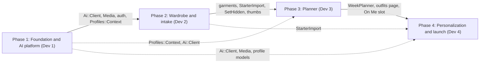
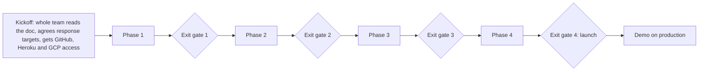

# MisfitAI (AI Wardrobe Planner): Ruby on Rails Rewrite Design Doc, v2 (relay model)

| | |
|---|---|
| Status | Approved for implementation |
| Version | v2. Supersedes [v1](ruby_rewrite_design_doc.md) for team organization. The product design is unchanged. |
| Team | 4 developers (Dev 1, Dev 2, Dev 3, Dev 4), one per phase |
| Timeline | 4 sequential phases. Each phase is built in one sitting by one developer, who stays reachable afterwards for questions and bug fixes. |
| Stack | Ruby 3.3, Rails 8 (Hotwire), PostgreSQL, Heroku, Cucumber + RSpec |
| AI | Google Vertex AI (Gemini + Imagen) on the $300 GCP free trial; Discovery Engine Grounded Generation + Ranking on the "GenAI App Builder" trial credit |
| Reference implementation | This repository (FastAPI backend in `backend/`, Expo app in `misfitai-mobile/`) |

This document is written so that each developer (or their coding agent) can build their workstream without reading the Python/TypeScript source. Every constant, keyword list, prompt, and rule that matters is copied in here. When this doc and the old code disagree, **this doc wins**. Every deliberate change from the original is marked **[CHANGE]**.

> **Changes from v1**
>
> v1 split the work by feature area across four developers working in parallel for 9 days, held together by Day-1 stubs and daily integration. v2 splits the same work into **four back-to-back phases in dependency order**. Each phase only consumes code that earlier phases have already built for real, so there are no stubs and no parallel merge conflicts. In their place is a strict handoff protocol ([10.4](#104-handoff-protocol)).
>
> | Phase | Developer | Scope | Moved in from v1 |
> |---|---|---|---|
> | 1. Foundation and AI platform | Dev 1 | Skeleton, schema, CI, Heroku, GCP, layout, auth, `Profiles::Context`, the whole `Ai::Client`, `Media::*`, Rack::Attack | The AI platform and media helpers (v1 Dev D) |
> | 2. Wardrobe and intake | Dev 2 | Garments, wardrobe page, manual add, search, photo intake, receipts, starter import | Receipts (v1 Dev D) |
> | 3. Planner | Dev 3 | Week plan, calendar sync, engine, explanations, Outfits page, weather stub | Nothing |
> | 4. Personalization and launch | Dev 4 | Profile UI, onboarding, stepper, avatar, outfit-on-me, metrics, hardening, demo | Profile, onboarding, navigation (v1 Dev A) |
>
> Sections changed: the header, the decision log (D15, D16), owner labels in 1 to 9, testing rules in [8](#8-testing-strategy), and all of [10](#10-team-division-of-labor-relay-model), [11](#11-phase-sequence), and [12.1](#121-cucumber-feature-catalog) and [12.5](#125-agent-instruction-blocks). The stack, AI routing, schema, feature specs, routes, and deployment are the same as v1.

## Table of contents

1. [Context and goals](#1-context-and-goals)
2. [Tech stack and architecture](#2-tech-stack-and-architecture)
3. [AI and cost strategy](#3-ai-and-cost-strategy)
4. [Architecture rules](#4-architecture-rules)
5. [Data model](#5-data-model)
6. [Feature specifications](#6-feature-specifications)
7. [Routes and screens](#7-routes-and-screens)
8. [Testing strategy](#8-testing-strategy)
9. [Heroku deployment and configuration](#9-heroku-deployment-and-configuration)
10. [Team division of labor (relay model)](#10-team-division-of-labor-relay-model)
11. [Phase sequence](#11-phase-sequence)
12. [Appendices](#12-appendices)

### Decision log (summary)

Each decision is explained where it applies. They are listed here so reviewers can find them quickly.

| ID | Decision |
|---|---|
| D1 | A single Rails 8 monolith with a Hotwire UI that works well on phones. There is no separate JS app and no native app. |
| D2 | Full feature parity with the original, including avatar, "outfit on me", receipts, and metrics. |
| D3 | Vertex AI (Gemini and Imagen) is paid from the $300 GCP free trial. Text-only explanations go through the Grounded Generation API, which the GenAI App Builder credit covers. |
| D4 | The browser holds a session cookie (Devise) and every query is scoped to `current_user`. User ids never appear in URLs. **[CHANGE]** The original trusted a `user_id` in the URL path. |
| D5 | Google OAuth runs on the server, and the server keeps an encrypted refresh token. Calendar sync happens on the server. **[CHANGE]** The original kept the token in browser memory. |
| D6 | Any call that may take more than about 2 seconds (AI, image downloads, calendar) runs in a Solid Queue job. Results reach the page through Turbo Streams. This is required by Heroku's 30-second router timeout. |
| D7 | Week plans, events, and recommendations are stored in Postgres. **[CHANGE]** The original kept them in memory and lost them on restart. |
| D8 | The server picks outerwear and shoes. **[CHANGE]** The original picked them in client-side display code. |
| D9 | The week runs Monday to Sunday in the user's time zone. **[CHANGE]** The original used UTC. |
| D10 | Starter, receipt, and search garments are saved right away with a placeholder image. Their real images arrive later from background jobs. **[CHANGE]** The original made the user wait for image generation to finish. |
| D11 | Apple sign-in, closet-video ingestion, and the YOLO/SAM/CLIP vision stack are out of scope. |
| D12 | Weather stays a stub, as in the original. Open-Meteo integration is a stretch goal. |
| D13 | Every image lives in Active Storage on one Google Cloud Storage bucket. Images found through search are downloaded into storage instead of hotlinked. |
| D14 | One Heroku Basic dyno runs Puma with Solid Queue inside it. Solid Queue, Solid Cable, and Solid Cache all live in the single Essential-0 Postgres database. |
| D15 | **[v2]** The app is built in four sequential phases, in dependency order: foundation and AI platform, then wardrobe, then planner, then personalization and launch. Each phase consumes only real code from earlier phases. There are no stubs, except the few forward slots in [10.3](#103-forward-slots). |
| D16 | **[v2]** Every phase ends with the handoff protocol in [10.4](#104-handoff-protocol): an exit gate, a handoff note, a deviation log, and a git tag. Each phase's developer stays the bug-fix owner for the paths they built, and stays reachable after their sitting. |

---

## 1. Context and goals

### 1.1 Product summary

MisfitAI is a personal wardrobe planner.

1. **Digitize the closet.** The user adds garments in one of five ways:
   - typing them in manually,
   - searching Google Images and picking a product photo,
   - uploading an outfit photo for the AI to split into garments,
   - uploading a receipt (screenshot, PDF, or pasted text),
   - picking items from a starter catalog during onboarding.
2. **Know the week.** The app gets one event type per day for the current week. It can sync Google Calendar, use a demo week, or let the user tap per-day pills. The event types are work meeting, date night, gym, casual, and no major event.
3. **Recommend outfits.** A rules engine picks one outfit per day from the wardrobe (top + bottom or a dress, plus optional outerwear and shoes). An LLM writes a one-sentence explanation for each outfit.
4. **Visualize.** The user can generate an illustrated avatar from a selfie. The app can then render the day's outfit on that avatar ("On Me").
5. **Measure.** The team gets an internal metrics endpoint (signups, active users, page views, waitlist) for the startup studio dashboard.

Brand: the wordmark is **misfitAI**. The UI is a light, editorial, mostly monochrome design (see [7.3](#73-design-system)).

### 1.2 Parity map (original to Ruby)

The Owner column names the phase (and its developer) that builds the piece and stays its bug-fix owner.

| Original (Python/TS) | Responsibility | Ruby counterpart | Owner |
|---|---|---|---|
| `backend/routers/auth_router.py`, `AuthScreen.tsx` | Email/password + Google sign-in | Devise + `Users::OmniauthCallbacksController` | Phase 1 (Dev 1) |
| `backend/routers/profile_router.py`, `ProfileScreen.tsx` | Profile, sizes, colors | `UserProfile` model (Phase 1); `ProfilesController` (Phase 4) | Phase 1 + Phase 4 |
| `main.py` measurements endpoints | Body measurements | `BodyMeasurement` model (Phase 1); `MeasurementsController` (Phase 4) | Phase 1 + Phase 4 |
| `main.py` style-preferences | Aesthetics/brands/tones | columns on `UserProfile` | Phase 1 (columns), Phase 4 (UI) |
| `OnboardingFlow.tsx` | 5-step signup flow | `Onboarding::StepsController` | Phase 4 (Dev 4) |
| `main.py` wardrobe CRUD, hide, delete | Garments | `GarmentsController`, `Garment` | Phase 2 (Dev 2) |
| `main.py` search-garment + `garment_search_filter.py` | SerpAPI image search | `Wardrobe::Search::*` | Phase 2 (Dev 2) |
| `main.py` vision preview/commit + `vision/extractor.py` | Photo to garments | `Wardrobe::PhotoIntake::*` | Phase 2 (uses Phase 1's `Ai::Client`) |
| `main.py` starter-garment-preview + `vision/image_gen.py` | Product image generation | `Wardrobe::StarterImport`, `Wardrobe::GenerateGarmentImageJob` | Phase 2 (Dev 2) |
| `receipt_parser.py`, `ReceiptIngestCard.tsx` | Receipt parsing | `Receipts::*`, `Wardrobe::ReceiptsController` | Phase 2 (Dev 2) |
| `calendar_router.py`, `EventsScreen.tsx` | Calendar sync + manual week | `Planner::CalendarSync`, `WeekPlansController` | Phase 3 (Dev 3) |
| `recommendation.py`, `routers/recommendations.py` | Outfit engine | `Planner::RecommendationEngine` | Phase 3 (Dev 3) |
| `llm.py` | Outfit explanation | `Planner::ExplainOutfitJob` (Phase 3) + `Ai::Client#grounded_text` (Phase 1) | Phase 3 |
| `WeeklyPlanScreen.tsx`, `OutfitDetailModal.tsx` | Outfits UI | `OutfitsController` | Phase 3 (Dev 3) |
| `weather.py`, `weather_router.py` | Weather stub | `Planner::Weather` (stub) | Phase 3 (Dev 3) |
| `avatar_gen.py`, `routers/avatar_router.py` | Selfie to avatar | `Avatars::Generate*` | Phase 4 (Dev 4) |
| `outfit_on_avatar.py`, `outfit_composite.py`, `OutfitAvatarPreview.tsx` | Outfit on avatar | `Avatars::OutfitPreview*` | Phase 4 (Dev 4) |
| `analytics_metrics.py`, `routers/analytics_router.py`, `analytics.web.ts` | Metrics + GA4 | `Api::MetricsController`, `Analytics::*` | Phase 4 (Dev 4) |
| `.github/workflows/*`, `Dockerfile`, `firebase.json` | CI/CD, hosting | GitHub Actions + Heroku | Phase 1 (Dev 1) |

### 1.3 Goals

- Every user-facing capability listed in 1.1 works in production on Heroku by the end of Phase 4.
- Every user story is a passing Cucumber scenario. Every piece of logic (engine, parsers, filters, classifier) has RSpec unit tests.
- The total running cost stays inside the student Heroku credits plus the GCP trial credits.
- Each phase leaves `main` deployable and fully green, so the next developer starts from working software (see [10](#10-team-division-of-labor-relay-model)).

### 1.4 Non-goals (D11)

- **Closet-video / media-ingestion jobs.** The original `POST /media-ingestion` endpoint was a stub with no worker, so it is not rebuilt.
- **Apple sign-in.** It only mattered for the iOS app.
- **Native iOS/Android apps.** The Rails app is responsive and works in mobile browsers.
- **The YOLO/SAM/CLIP vision stack** from `vision_stack.md`. It was never built. The live system used Gemini plus image generation, and so does the rewrite.
- **Real weather.** It stays a stub. A stretch goal is defined in [6.13](#613-weather-stub-and-stretch).
- **The `ProfileSetupScreen.tsx` wizard.** It was never mounted in the original. The Profile page covers the same fields.

---

## 2. Tech stack and architecture

### 2.1 Locked stack

| Concern | Choice | Notes |
|---|---|---|
| Language | Ruby 3.3.x | Pin it in `.ruby-version` and the `Gemfile`. |
| Framework | Rails 8.0.x | `rails new misfit --database=postgresql --css=tailwind --skip-jbuilder --skip-kamal --skip-thruster` |
| Frontend | Hotwire (Turbo Drive, Frames, Streams) + Stimulus, importmap | No Node build. Add JS packages with `bin/importmap pin`. |
| CSS | `tailwindcss-rails` (Tailwind v4) | Theme tokens are in [7.3](#73-design-system). |
| DB | PostgreSQL 16 (Heroku Essential-0) | UUID primary keys (`pgcrypto`). |
| Jobs | Solid Queue, inside Puma (`SOLID_QUEUE_IN_PUMA=1`) | Shares the primary database (D14). |
| Realtime | Turbo Streams over Action Cable with the Solid Cable adapter | Shares the primary database. |
| Cache | Solid Cache | Shares the primary database. |
| Auth | Devise, `omniauth-google-oauth2`, `omniauth-rails_csrf_protection` | |
| Google APIs | `googleauth` (service account + user OAuth), `google-apis-calendar_v3`, `google-analytics-data-v1beta` | Vertex and Discovery Engine are called with Faraday (there is no official Ruby SDK). |
| HTTP | `faraday`, `faraday-retry`, `faraday-multipart` | |
| SSRF protection | `ssrf_filter` | Wrapped by `Media::SafeFetcher`. |
| Images | Active Storage, `image_processing` + `ruby-vips` | libvips ships with the Heroku-24 stack. |
| Storage | Google Cloud Storage via the Active Storage `GCS` service (`google-cloud-storage`) | One private bucket. |
| PDFs | `pdf-reader` | Receipt PDFs. |
| Rate limiting | `rack-attack` | |
| User stories | `cucumber-rails`, `capybara`, `cuprite` (headless Chrome over CDP) | |
| Unit tests | `rspec-rails`, `factory_bot_rails`, `webmock`, `shoulda-matchers` | |
| Quality | `rubocop-rails-omakase`, `brakeman`, `bundler-audit`, `simplecov` | |
| Hosting | Heroku (one Basic web dyno + Essential-0 Postgres) | Paid with GitHub Student Pack Heroku credits. |
| CI | GitHub Actions | Heroku auto-deploys `main` with "Wait for CI to pass". |

### 2.2 System diagram



### 2.3 Application layout

```text
app/
  controllers/
    application_controller.rb            # Phase 1
    users/omniauth_callbacks_controller.rb   # Phase 1
    onboarding/steps_controller.rb       # Phase 4
    profiles_controller.rb               # Phase 4
    measurements_controller.rb           # Phase 4
    garments_controller.rb               # Phase 2
    wardrobe/searches_controller.rb      # Phase 2
    wardrobe/photo_intakes_controller.rb # Phase 2
    wardrobe/drafts_controller.rb        # Phase 2
    wardrobe/receipts_controller.rb      # Phase 2
    week_plans_controller.rb             # Phase 3
    calendar_syncs_controller.rb         # Phase 3
    outfits_controller.rb                # Phase 3
    avatars_controller.rb                # Phase 4
    outfit_previews_controller.rb        # Phase 4
    api/metrics_controller.rb            # Phase 4
    admin/metrics_controller.rb          # Phase 4
    admin/ai_usage_controller.rb         # Phase 1
  models/                                # schema owner per table, see section 5
  services/
    profiles/      # Phase 1 (Context)
    navigation/    # Phase 4
    wardrobe/      # Phase 2
    receipts/      # Phase 2
    planner/       # Phase 3
    ai/            # Phase 1
    media/         # Phase 1
    avatars/       # Phase 4
    analytics/     # Phase 4
  jobs/            # same split as services (jobs live next to their domain by name prefix)
  views/           # one folder per controller, owned like the controller
  javascript/controllers/   # Stimulus; prefix files with domain: wardrobe_*, planner_*, ...
  views/shared/    # layout, nav, stepper, flash, form helpers partials (Phase 1; stepper added in Phase 4)
features/          # Cucumber, see section 8
spec/              # RSpec, mirrors app/
```

### 2.4 Request lifecycle for slow work (D6)



Rules:
- Pages that show async results call `<%= turbo_stream_from current_user, :wardrobe %>`, `<%= turbo_stream_from current_user, :planner %>`, or `<%= turbo_stream_from current_user, :avatar %>`. Each stream belongs to one domain owner.
- When a job broadcasts, it renders the **same partial** the page used for the first render. Each partial has one stable DOM id from `dom_id(record)`.
- Every job is idempotent. It can be retried safely and ends with the record in either `ready` or `failed` with an `error` message, never stuck in `pending`. Use `retry_on Ai::TransientError, wait: :polynomially_longer, attempts: 3` and `discard_on ActiveRecord::RecordNotFound`.

---

## 3. AI and cost strategy

### 3.1 What the free credits actually cover (research findings)

There are two separate Google Cloud credits, and they cover different products.

1. **"Trial credit for GenAI App Builder"** (the credit the team already has). It applies only to the products on the [Agent Search / AI Applications pricing page](https://cloud.google.com/generative-ai-app-builder/pricing):
   - Vertex AI Search (Agent Search),
   - the **Grounded Generation API** (`generateGroundedContent`),
   - the Check Grounding API,
   - the **Ranking API**,
   - Document AI features that are billed *through* Agent Search.

   It does **not** cover normal Gemini `generateContent` calls (neither through Vertex nor through AI Studio API keys), and it does **not** cover Imagen. Community and Google forum reports agree on this, for example [this r/googlecloud PSA](https://www.reddit.com/r/googlecloud/comments/1ldj0uf/psa_guide_how_to_actually_use_the_1000_genai_app/) and [this Google AI forum thread](https://discuss.ai.google.dev/t/google-ai-studio-do-not-use-my-1300-credits-shown-on-google-cloud/140442).
   - Grounded Generation takes **text only**. Its `Part` type holds only `text` (see [grounded-gen docs](https://docs.cloud.google.com/generative-ai-app-builder/docs/grounded-gen)). It cannot read images.
   - Grounded Generation pricing: Gemini token prices, plus $2.50 per 1,000 requests when grounding on inline facts or your own data. All of it is billed under the Discovery Engine service, so the credit pays for it.
2. **The standard $300 / 90-day Google Cloud free trial** (decision D3: the team will use it). It covers Vertex AI generally: Gemini `generateContent` (including image input), Imagen, and Gemini image-output models.

Consequence: text-only AI calls go to the GenAI App Builder credit wherever that is possible, and everything that involves images goes to the $300 trial.

### 3.2 Routing table (one row per AI feature)

| Feature (`kind`) | Input to output | API | Default model (ENV) | Paid by | Fallback chain |
|---|---|---|---|---|---|
| `outfit_explanation` | garment facts (text) to 1 sentence | Discovery Engine `generateGroundedContent` with `inlineSource` facts | `GROUNDED_MODEL=gemini-2.5-flash` | App Builder credit | Vertex `generateContent` (text), then template string |
| `receipt_structuring` (optional) | receipt text to items JSON | `generateGroundedContent` with receipt lines as facts | `GROUNDED_MODEL` | App Builder credit | keep the rule-parser output |
| `search_rank` (stretch) | query + result titles to order | Ranking API `rank` | `RANKING_MODEL=semantic-ranker-default@latest` | App Builder credit | the heuristic order from [6.5](#65-garment-image-search) |
| `garment_extraction` | outfit photo to garments JSON | Vertex `generateContent` + `responseSchema` | `VERTEX_VISION_MODEL=gemini-2.5-flash` | $300 trial | raise `Ai::Error`, which shows a "try a clearer photo" message |
| `receipt_extraction` | receipt image to items JSON | Vertex `generateContent` + `responseSchema` | `VERTEX_VISION_MODEL` | $300 trial | raise |
| `selfie_description` | selfie to 150-400 words of prose | Vertex `generateContent` | `VERTEX_VISION_MODEL` | $300 trial | skip it (portrait from profile fields only) |
| `garment_image` | product prompt to 1:1 image | Vertex Imagen `predict` | `IMAGEN_MODEL=imagen-4.0-fast-generate-001` | $300 trial | category placeholder image |
| `avatar_portrait` | portrait prompt to 1:1 image | Vertex Imagen `predict` | `AVATAR_IMAGEN_MODEL=imagen-4.0-fast-generate-001` | $300 trial | raise (user sees an error and can retry) |
| `outfit_preview_subject` | avatar + outfit text to 9:16 image | Vertex Imagen subject customization | `OUTFIT_SUBJECT_MODEL=imagen-3.0-capability-001` | $300 trial | `outfit_preview_gemini` |
| `outfit_preview_gemini` | avatar + garment images to image | Vertex `generateContent` with `responseModalities: ["TEXT","IMAGE"]` | `OUTFIT_GEMINI_IMAGE_MODEL=gemini-2.5-flash-image` | $300 trial | vips collage ([6.10](#610-outfit-on-me-avatar-outfit-preview)) |

All model ids come from ENV. The defaults above match what the original used or the current GA equivalent. **Dev 1 runs an AI spike at the start of Phase 1** (`bin/ai_smoke`, see [3.6](#36-phase-1-ai-spike-dev-1)) to confirm every model is reachable on the trial billing account in `GOOGLE_CLOUD_LOCATION=us-central1`. Any substitutions are recorded in the README.

### 3.3 REST endpoints (Faraday, no SDK)

All calls send the header `Authorization: Bearer <access token>`. The token comes from the service account with scope `https://www.googleapis.com/auth/cloud-platform` (see [3.4](#34-authenticating-to-google-from-heroku)).

**Gemini generateContent (Vertex):**

```text
POST https://{LOCATION}-aiplatform.googleapis.com/v1/projects/{PROJECT_ID}/locations/{LOCATION}/publishers/google/models/{MODEL}:generateContent
```

```json
{
  "systemInstruction": {"parts": [{"text": "..."}]},
  "contents": [{"role": "user", "parts": [
    {"text": "prompt"},
    {"inlineData": {"mimeType": "image/jpeg", "data": "<base64>"}}
  ]}],
  "generationConfig": {
    "temperature": 0.2,
    "maxOutputTokens": 2048,
    "responseMimeType": "application/json",
    "responseSchema": { "...OpenAPI subset schema..." : "" },
    "thinkingConfig": {"thinkingBudget": 0}
  }
}
```

Read the text from `candidates[0].content.parts[*].text`, joining every text part. When `responseMimeType` is JSON, `JSON.parse` the text. Set `thinkingBudget: 0` for `gemini-2.5-*` models; this matches the original and keeps latency and cost low. The image-output model needs `"responseModalities": ["TEXT", "IMAGE"]`, and the image arrives as a part with `inlineData`.

**Imagen predict (text to image):**

```text
POST https://{LOCATION}-aiplatform.googleapis.com/v1/projects/{PROJECT_ID}/locations/{LOCATION}/publishers/google/models/{IMAGEN_MODEL}:predict
```

```json
{
  "instances": [{"prompt": "..."}],
  "parameters": {"sampleCount": 1, "aspectRatio": "1:1", "personGeneration": "allow_adult", "addWatermark": true, "outputOptions": {"mimeType": "image/png"}}
}
```

The response is `predictions[0].bytesBase64Encoded`. If `predictions` is empty, or the response carries `raiFilteredReason`, raise `Ai::ContentBlockedError`.

**Imagen subject customization (outfit on avatar):** `imagen-3.0-capability-001` uses the same `:predict` URL with:

```json
{
  "instances": [{
    "prompt": "Full body fashion illustration of person [1] wearing ...",
    "referenceImages": [{
      "referenceType": "REFERENCE_TYPE_SUBJECT",
      "referenceId": 1,
      "referenceImage": {"bytesBase64Encoded": "<avatar jpeg base64>"},
      "subjectImageConfig": {"subjectType": "SUBJECT_TYPE_PERSON", "subjectDescription": "illustrated person"}
    }]
  }],
  "parameters": {"sampleCount": 1, "aspectRatio": "9:16", "personGeneration": "allow_adult"}
}
```

**Grounded Generation (App Builder credit):**

```text
POST https://discoveryengine.googleapis.com/v1/projects/{PROJECT_NUMBER}/locations/global:generateGroundedContent
```

```json
{
  "systemInstruction": {"parts": [{"text": "<stylist system prompt>"}]},
  "contents": [{"role": "user", "parts": [{"text": "Day: Monday | Event: work meeting. Explain this outfit."}]}],
  "groundingSpec": {"groundingSources": [{"inlineSource": {"groundingFacts": [
    {"factText": "Top: Uniqlo shirt — white — business — cotton", "attributes": {"title": "top"}},
    {"factText": "Bottom: chinos — khaki — smart-casual", "attributes": {"title": "bottom"}}
  ]}}]},
  "generationSpec": {"modelId": "gemini-2.5-flash", "temperature": 0.7}
}
```

The text is in `candidates[0].content.parts[0].text`. Note: the URL takes the **project number**, not the project id (`GOOGLE_CLOUD_PROJECT_NUMBER`).

**Ranking API (stretch):**

```text
POST https://discoveryengine.googleapis.com/v1/projects/{PROJECT_ID}/locations/global/rankingConfigs/default_ranking_config:rank
{"model": "semantic-ranker-default@latest", "query": "...", "topN": 8, "records": [{"id": "0", "title": "...", "content": "..."}]}
```

### 3.4 Authenticating to Google from Heroku

Heroku has no Application Default Credentials, so authentication uses a **service account JSON key** stored in one config var.

```ruby
# app/services/ai/google_token.rb (Phase 1)
module Ai
  class GoogleToken
    SCOPE = "https://www.googleapis.com/auth/cloud-platform".freeze
    @mutex = Mutex.new
    class << self
      def fetch
        @mutex.synchronize do
          if @token.nil? || @expires_at < 60.seconds.from_now
            creds = Google::Auth::ServiceAccountCredentials.make_creds(
              json_key_io: StringIO.new(ENV.fetch("GOOGLE_SERVICE_ACCOUNT_JSON")), scope: SCOPE)
            data = creds.fetch_access_token!
            @token = data["access_token"]
            @expires_at = Time.current + data["expires_in"].to_i.seconds
          end
          @token
        end
      end
    end
  end
end
```

GCP one-time setup (Dev 1, start of Phase 1; record it in `docs/runbook.md`). Add all four developers to the GCP project and the Heroku app at this point, so later phases are never blocked on access:
1. Use the GCP project whose billing account holds the $300 trial and the App Builder credit. Both credits must sit on the **same billing account**.
2. Enable these APIs: `aiplatform.googleapis.com`, `discoveryengine.googleapis.com`, `calendar-json.googleapis.com`, `analyticsdata.googleapis.com`, `storage.googleapis.com`.
3. Create the service account `misfit-heroku@...` and grant it `roles/aiplatform.user`, `roles/discoveryengine.user`, and `roles/storage.objectAdmin` on the bucket only. Add its email as a **Viewer** on the GA4 property.
4. Create a JSON key and put the whole JSON into the Heroku config var `GOOGLE_SERVICE_ACCOUNT_JSON`. Never commit it.
5. Create the GCS bucket `misfit-<env>-media` in `us-central1` with uniform access and no public access.
6. Billing reports lag by up to a day. So the check happens twice: Dev 1 at the Phase 1 exit gate (after `bin/ai_smoke`), and Dev 2 at the start of Phase 2. Open **Billing > Reports** grouped by Service. Confirm that "Discovery Engine" usage is being offset by the App Builder credit and that "Vertex AI" usage is being offset by the free-trial credit. Record the result in the handoff note. If either is not, tell the team immediately.

### 3.5 Cost guardrails

The `ai_calls` table ([5.3](#53-tables)) logs every call: `kind`, `model`, `status`, `latency_ms`, `input_chars`, `output_chars`, `images_in`, `images_out`, `est_cost_cents`, and `user_id`. The logging wrapper lives in `Ai::Client` itself, so callers cannot skip it.

| Control | ENV | Default | Behavior |
|---|---|---|---|
| Global image kill switch | `AI_IMAGE_GEN_ENABLED` | `true` | When `false`, image kinds raise `Ai::DisabledError`. Callers fall back to a placeholder or the collage. |
| Per-user daily image cap | `AI_DAILY_IMAGE_LIMIT` | `40` | Counts `ai_calls` with `images_out > 0` for the user since midnight UTC. Over the cap, raise `Ai::QuotaExceededError`. |
| Per-user daily vision cap | `AI_DAILY_VISION_LIMIT` | `30` | Same check for the image-input kinds. |
| Global daily spend cap | `AI_DAILY_BUDGET_CENTS` | `1000` ($10) | Sums `est_cost_cents` for today. Over the cap, every paid kind raises `Ai::QuotaExceededError`. |
| Photo garments per upload | `VISION_MAX_GARMENT_IMAGES` | `6` | Same as the original. |
| Spacing between image generations in one job | `IMAGE_GEN_SPACING_SEC` | `1.5` | Same as the original. |

The estimated cost table used by `est_cost_cents` lives in `config/ai_pricing.yml`. Prices below are list prices at the time of writing; Dev 1 re-checks them in Phase 1.

| kind | est. cost per call |
|---|---|
| `garment_image`, `avatar_portrait` (Imagen 4 Fast) | about $0.02 |
| `outfit_preview_subject` (Imagen 3 capability) | about $0.04 |
| `outfit_preview_gemini` (Gemini image) | about $0.04 |
| `garment_extraction`, `receipt_extraction`, `selfie_description` (Gemini 2.5 Flash, 1 image) | under $0.005 |
| `outfit_explanation` (grounded) | about $0.003 (credit) |

Rough budget: one fully onboarded user costs about **$0.60**. That covers 10 starter images, one photo intake of 4 items, an avatar, and 7 outfit previews. So the $300 trial covers roughly 500 heavy users. The trial expires after **90 days**. A free-trial billing account stops charging when the credit runs out instead of billing a card, which is a natural safety net.

### 3.6 Phase-1 AI spike (Dev 1)

`bin/ai_smoke` is a Ruby script run with `bin/rails runner`. It calls every `kind` once against the real APIs and prints the model, HTTP status, latency, and output size. It also writes the images to `tmp/ai_smoke/`. Run it first thing in Phase 1, before writing the Vertex adapter in full, so model-access problems surface early. It must pass for all ten kinds (or have a documented substitute) before Phase 1 can exit. Paste the output into `docs/handoff/phase-1.md`. Every later developer re-runs it as part of their entry checklist ([10.5](#105-entry-checklist-for-the-incoming-developer)).

### 3.7 The `Ai::Client` contract (shared interface, frozen at the end of Phase 1)

Every developer codes against this interface. Nobody calls Vertex or Discovery Engine directly.

```ruby
# app/services/ai/client.rb (Phase 1)
module Ai
  Image = Data.define(:bytes, :mime_type)

  class Error < StandardError; end
  class TransientError < Error; end        # 429, 5xx, timeouts -> jobs retry
  class ContentBlockedError < Error; end   # safety filter / empty result
  class QuotaExceededError < Error; end    # our own caps (section 3.5)
  class DisabledError < Error; end         # kill switch

  class Client
    # Returns Ai::Client::Vertex in production/dev, Ai::Client::Fake when AI_ADAPTER=fake (test, CI).
    def self.current; end

    # Vertex Gemini, structured output. schema is a Ruby Hash in Gemini responseSchema format.
    # Returns the parsed Hash. images: Array<Ai::Image>.
    def generate_json(kind:, prompt:, schema:, images: [], system: nil, user: nil,
                      temperature: 0.2, max_output_tokens: 2048) = raise(NotImplementedError)

    # Vertex Gemini, plain text.
    def generate_text(kind:, prompt:, images: [], system: nil, user: nil,
                      temperature: 0.7, max_output_tokens: 512) = raise(NotImplementedError)

    # Discovery Engine generateGroundedContent (text only). facts: Array<{text:, title:}>.
    def grounded_text(kind:, prompt:, facts:, system: nil, user: nil, temperature: 0.7) = raise(NotImplementedError)

    # Imagen text-to-image. Returns Ai::Image (PNG or JPEG bytes).
    def generate_image(kind:, prompt:, aspect_ratio: "1:1", user: nil) = raise(NotImplementedError)

    # Imagen subject customization. subject: Ai::Image.
    def generate_image_with_subject(kind:, prompt:, subject:, aspect_ratio: "9:16", user: nil) = raise(NotImplementedError)

    # Gemini image-output model with image inputs.
    def generate_image_multimodal(kind:, prompt:, images:, user: nil) = raise(NotImplementedError)

    # Ranking API. records: Array<{id:, title:, content:}>. Returns Array<{id:, score:}> sorted desc.
    def rank(kind:, query:, records:, top_n: 10) = raise(NotImplementedError)
  end
end
```

**Fake adapter rules** (`Ai::Client::Fake`), which make tests deterministic:
- `generate_json` returns the fixture `spec/fixtures/ai/<kind>.json`. A test can override it with `Ai::Client::Fake.stub(kind, value)`, where `value` is a Hash or an exception to raise.
- `generate_text` and `grounded_text` return `"Fake #{kind}: #{facts.map { _1[:text] }.join(' + ')}"`, or whatever was stubbed.
- The image methods return the bytes of `spec/fixtures/ai/<kind>.png`, a small 64x64 PNG with a distinct color per kind.
- It records every call in `Ai::Client::Fake.calls` so tests can assert on prompts.
- It still writes `ai_calls` rows, so the budget logic gets tested too.
- `Ai::Client::Fake.reset!` runs in a `Before` hook (Cucumber) and a `before` hook (RSpec).

---

## 4. Architecture rules

### 4.1 Authorization (D4)

- `ApplicationController` has `before_action :authenticate_user!` by default. Only Devise pages, `/up`, `/terms`, `/privacy`, and `/api/metrics` skip it.
- **Every** query starts from `current_user`: `current_user.garments.find(params[:id])`, `current_user.week_plans...`. Never use `Garment.find(params[:id])`. Code review rejects any unscoped `find` in a controller. RuboCop cannot catch this, so reviewers must.
- No URL contains a user id. The routes in [7.1](#71-route-table) are all singular resources or nested under the current user implicitly.
- `ApplicationController` also has `before_action :require_onboarding!`, which redirects to `/onboarding` when `current_user.onboarding_completed_at.nil?`. It is skipped by onboarding, profile, and Devise controllers. **[v2]** Phase 1 writes this filter but guards it with `Feature.enabled?(:onboarding)`, which stays off until Phase 4 turns it on. Until then, signed-in users land on `/wardrobe` (a forward slot, see [10.3](#103-forward-slots)).
- Users who sign in with Google and users who use email and password are both `User` rows. See [6.1](#61-authentication-and-accounts) for how accounts are linked.

### 4.2 Module boundaries and contracts

Each domain exposes a few **service objects** with keyword arguments and documented return values. Code in another domain may call only these public entry points, plus the ActiveRecord models in read-only fashion (for example `user.garments.visible`). Writes to another domain's tables always go through that domain's service.

| Contract | Owner | Signature | Returns / side effects |
|---|---|---|---|
| AI gateway | Phase 1 | `Ai::Client.current` (see [3.7](#37-the-aiclient-contract-shared-interface-frozen-at-the-end-of-phase-1)) | |
| Safe remote fetch | Phase 1 | `Media::SafeFetcher.fetch(url, max_bytes: 10.megabytes, timeout: 10)` | Returns `Ai::Image` (`bytes`, `mime_type`). Raises `Media::UnsafeUrlError` or `Media::FetchError`. |
| Image normalize | Phase 1 | `Media::ImageNormalizer.to_square_jpeg(bytes, size: 512, background: "#ffffff")` | Returns JPEG bytes (fits the image to a square on a white canvas, quality 92). |
| Sniff image | Phase 1 | `Media::ImageNormalizer.sniff!(bytes, allowed: %w[image/jpeg image/png image/webp image/heic])` | Returns the mime type. Raises `Media::InvalidImageError`. |
| Profile context | Phase 1 | `Profiles::Context.for(user)` | Returns `Profiles::Context` (a `Data` struct): `gender`, `color_tone`, `favorite_colors`, `avoided_colors`, `skin_tone`, `hair_style`, `hair_color`, `body_type`, `top_size`, `bottom_size`, `shoe_size`, `measurements` (a Hash with symbol keys, or `nil`), `avatar_attached?`. |
| Starter import | Phase 2 | `Wardrobe::StarterImport.call(user:, items:)`. `items` is an Array of Hashes with `name, category, color, size, formality, seasonality` | Creates garments right away (placeholder image) and enqueues `Wardrobe::GenerateGarmentImageJob` for each. Returns `Array<Garment>`. |
| Bulk add | Phase 2 | `Wardrobe::AddGarments.call(user:, items:, source:)` | Same as above for `source: :receipt`, with an option `generate_images: true/false`. |
| Week planner | Phase 3 | `Planner::WeekPlanner.ensure_week!(user:, week_start: Planner::Week.current_start(user))` | Returns a `WeekPlan` that has 7 `WeekEvent` rows (defaults to `none`). |
| Demo week | Phase 3 | `Planner::WeekPlanner.apply_demo_week!(week_plan)` | Writes the demo map ([6.7](#67-week-plan-and-calendar-sync)). |
| Generate outfits | Phase 3 | `Planner::WeekPlanner.generate!(user:, week_plan:)` | Replaces the plan's `OutfitRecommendation` rows and enqueues explanation jobs. Returns `Array<OutfitRecommendation>`. Synchronous and fast: DB work only, no AI in the request. |
| Garment hide | Phase 2 | `Wardrobe::SetHidden.call(user:, garment:, hidden:)` | Updates the flag and broadcasts the card refresh to the wardrobe stream. Phase 3's outfit page calls it too. |

**[v2]** Because phases run in order, every contract above is built for real by its owner phase before any consumer phase starts. A consumer that needs a contract changed opens an issue for the owner phase's developer ([10.6](#106-bug-routing-and-availability)), or makes the change itself and records a `[DEVIATION]` in its handoff note.

`Data` structs (Ruby 3.2+) are used for every value object that crosses a boundary.

### 4.3 Errors and user feedback

- Domain errors are subclasses of `ApplicationError < StandardError`, and each carries `user_message`.
- Controllers `rescue_from ApplicationError`. They render a flash, or a `turbo_stream.replace "flash"` for Turbo requests.
- Failed jobs store `error` on the record and render a "failed" partial with a Retry button. The button POSTs to the domain's `retry` member route.
- User-facing copy is kept close to the original, for example: "No garments detected from image. Please upload a clearer outfit photo."

### 4.4 Security baseline

| Area | Rule |
|---|---|
| SSRF | Every server-side fetch of a user-influenced URL (search results) goes through `Media::SafeFetcher`. It uses `ssrf_filter`, which resolves DNS and blocks private, loopback, link-local, and metadata ranges (`10/8, 172.16/12, 192.168/16, 127/8, 169.254/16, 0/8, ::1, fc00::/7, fe80::/10`, plus the hostnames `metadata.google.internal`, `metadata.azure.com`, `100.100.100.200`). Only `http` and `https` are allowed. Responses are limited to 10 MB, a 10 s timeout, and 3 redirects (each redirect re-checked). Our own Active Storage blobs are read with `blob.download`, never by URL. |
| Uploads | The server checks the magic bytes with vips/Marcel and ignores the client's Content-Type. Allowed: JPEG, PNG, WebP, and HEIC (only if libvips on Heroku has HEIF support, verified in Phase 1; otherwise reject HEIC with "Please upload JPEG or PNG"). Max 15 MB for photos and selfies, 10 MB for receipts. PDFs are allowed for receipts only. |
| CSRF | Rails defaults. `omniauth-rails_csrf_protection` makes Google sign-in POST only. |
| Secrets | Rails credentials hold only the Active Record Encryption keys. Everything else lives in Heroku config vars ([9.3](#93-config-vars)). |
| Token storage | `google_access_token` and `google_refresh_token` use `encrypts`. |
| Rate limits (Rack::Attack) | `POST` to `/wardrobe/photo_intakes`, `/wardrobe/searches`, `/wardrobe/receipts`, `/avatar`, and `/outfits/*/preview`: 10 per minute per user, 60 per hour per user. Login: 5 per 20 s per IP and per email. `/api/metrics`: 30 per minute per IP. |
| Headers | CSP with `default-src 'self'`; `img-src 'self' data: https://storage.googleapis.com https://*.googleusercontent.com https://www.google-analytics.com`; scripts from self and `https://www.googletagmanager.com`. Also `X-Frame-Options: DENY`, `Referrer-Policy: strict-origin-when-cross-origin`. `force_ssl` is on in production. |
| Privacy | Selfies are never stored past the avatar job (the blob is purged in an `ensure`). The facial description is not logged unless `AVATAR_LOG_PROMPT_PREVIEW=true`. Static `/privacy` and `/terms` pages are copied from `misfitai-mobile/static-pages/`. |
| Static analysis | Brakeman and bundler-audit run in CI and must have zero warnings. |

### 4.5 Logging and observability

- Use `Rails.logger` tagged with `request_id` and `user_id`.
- Every job logs one line when it starts and one when it finishes, with the duration.
- `Ai::Client` logs `kind`, `model`, `status`, and `latency_ms`, never prompts with PII.
- Health check: the Rails 8 default `/up`.
- `GET /admin/ai_usage` (requires the `X-Analytics-Key` header) returns today's `ai_calls` aggregates by kind, so the team can watch spend.

---

## 5. Data model

### 5.1 Conventions

- Primary keys are UUIDs (`id: :uuid`, `default: -> { "gen_random_uuid()" }`). Set `config.generators { |g| g.orm :active_record, primary_key_type: :uuid }`.
- Every table has `created_at` and `updated_at`.
- Enums are **Postgres string columns** with Rails `enum ..., validate: true` and string values. That keeps the database readable and stays compatible with the original values.
- Arrays are Postgres `text[]` with default `[]`.
- Money is stored as `price_cents` (integer).

### 5.2 Entity diagram



### 5.3 Tables

Dev 1 writes **all** of these migrations in Phase 1 (one PR), including the tables later phases will fill. This keeps the schema reviewable in one place and means every model's columns exist before its feature is built. Later phases add columns or indexes in their own migration files whenever they need to; because only one developer works at a time, there are no `schema.rb` conflicts. Each schema change is listed in that phase's handoff note. The "owner" below is the phase that builds the feature and the table's model logic.

#### `users` (owner: Phase 1)

| Column | Type | Notes |
|---|---|---|
| id | uuid PK | |
| email | string, not null, unique index (lower) | Devise. |
| encrypted_password | string, not null, default "" | Devise. Google-only users get a random password. |
| reset_password_token, reset_password_sent_at, remember_created_at | Devise defaults | |
| name | string | From Google or the signup form. |
| provider | string | `"google_oauth2"` or `nil`. |
| uid | string | Google `sub`. Unique index on `[provider, uid]`. |
| google_access_token | text, encrypted | |
| google_refresh_token | text, encrypted | |
| google_token_expires_at | datetime | |
| google_calendar_connected_at | datetime | Set after the first successful sync. |
| time_zone | string, not null, default "America/New_York" | Set from the browser on first page load (Stimulus `timezone_controller`). |
| onboarding_completed_at | datetime | `nil` means the user has not finished onboarding yet. |
| onboarding_step | integer, not null, default 0 | The step to resume, 0 to 4 ([6.3](#63-onboarding)). |

Devise modules: `:database_authenticatable, :registerable, :recoverable, :rememberable, :validatable, :omniauthable` with `omniauth_providers: [:google_oauth2]`. Password length is 8 to 72 (the bcrypt limit, same as the original). Emails are downcased (Devise default).

#### `user_profiles` (owner: Phase 1 for the model; Phase 4 for the profile UI and avatar columns)

One row per user, created by an `after_create` callback on `User`.

| Column | Type | Allowed values |
|---|---|---|
| user_id | uuid FK, unique | |
| gender | string | `female`, `male`, `other`, or `nil` |
| birthday | date | Optional. |
| skin_tone | string | `very_light`, `light`, `medium_light`, `medium`, `medium_dark`, `dark` |
| color_tone | string | `warm`, `cool`, `neutral` |
| favorite_colors | text[] | Keys from [12.3](#123-option-lists). |
| avoided_colors | text[] | Same keys. |
| top_size | string | `XS, S, M, L, XL, XXL` |
| bottom_size | string | `XS, S, M, L, XL, XXL` |
| shoe_size | string | Free text, max 10 characters. |
| hair_style | string | `short_straight, short_wavy, long_straight, long_wavy, curly_afro, bald` |
| hair_color | string | `black, dark_brown, light_brown, auburn, blonde, red, grey, white` |
| body_type | string | `slim, average, broad` |
| aesthetics | text[] | `casual, streetwear, business_casual, maximalist, minimalist, sporty` |
| brands | text[] | Free strings from the brand list. |
| style_color_tones | text[] | `neutrals, warm, cool, bold, all` (onboarding "color tones", which is a different thing from `color_tone`) |
| avatar_status | string, default `none` | `none, pending, ready, failed` |
| avatar_error | string | |
| **attachments** | `has_one_attached :avatar` | The generated portrait. |

#### `body_measurements` (owner: Phase 1 for the model; Phase 4 for the UI)

| Column | Type |
|---|---|
| user_id | uuid FK, unique |
| height_cm, weight_kg, chest_cm, waist_cm, hips_cm, inseam_cm | decimal(5,1), nullable; validation `> 0` and `< 300` |

#### `garments` (owner: Phase 2)

| Column | Type | Notes |
|---|---|---|
| user_id | uuid FK, index | |
| name | string, not null | The display name. It replaces the original's overloaded `sub_category` name field, for example "White Oxford Shirt". |
| category | string, not null | `top, bottom, dress, outerwear, shoes, accessory` |
| sub_category | string | Normalized snake_case kind, for example `t_shirt`, `jeans`, `blazer`. Optional. |
| color_primary | string | Lowercase color word(s). |
| color_secondary | string | |
| pattern | string | `nil` means solid ([6.6](#66-photo-ai-intake)). |
| material | string | |
| formality | string | `casual, smart_casual, business, formal`, or `nil` (untagged) |
| seasonality | string | `hot, mild, cold, all_season`, or `nil` |
| gender | string | `men, women, unisex`, or `nil` |
| brand | string | |
| size | string | |
| fit_notes | string | |
| price_cents | integer | From receipts. |
| source | string, not null | `manual, search, photo, receipt, starter` |
| source_url | string | The search result page or image URL, kept for reference only. |
| image_status | string, not null, default `ready` | `pending, ready, failed, placeholder` |
| times_recommended | integer, not null, default 0 | |
| hidden_from_recommendations | boolean, not null, default false | |
| **attachments** | `has_one_attached :image` | With the variants `thumb: resize_to_fill [256,256]` and `card: resize_to_limit [512,512]`. |

Scopes: `visible` (not hidden), `by_category(cat)`, `recent` (`created_at desc`).
Method `image_or_placeholder_url`: returns the attached image, otherwise `asset_path("placeholders/#{category}.jpg")`.
Method `tags`: derived, `[category, formality, seasonality].compact` (same as the original `build_garment_tags`). It is used by the engine's text matching.
Index: `[user_id, category]`.

#### `intake_batches` (owner: Phase 2, including `receipt` rows)

| Column | Type | Notes |
|---|---|---|
| user_id | uuid FK | |
| kind | string | `photo, receipt` |
| status | string | `pending, processing, ready, failed` |
| progress | integer, default 0 | 0 to 100. |
| error | string | |
| parser_strategy | string | Receipts only: `text_rules, pdf_text_rules, image_vision, plain_text_rules`. |
| extracted_text_preview | text | Receipts only, up to 600 characters. |
| **attachments** | `has_one_attached :source_file` | The uploaded photo or receipt. Purged after processing. |

#### `garment_drafts` (owner: Phase 2, including receipt drafts)

| Column | Type | Notes |
|---|---|---|
| intake_batch_id | uuid FK | |
| user_id | uuid FK | Denormalized for scoping. |
| status | string | `pending, ready, failed, committed, discarded` |
| attrs | jsonb, not null, default {} | Keys match the `garments` columns: `name, category, sub_category, color_primary, pattern, material, fit_notes, formality, seasonality, brand, size, price_cents`. Receipts also store `confidence` (float) and `needs_confirmation` (bool). |
| selected | boolean, default true | The review checkbox. |
| position | integer | Display order. |
| error | string | |
| **attachments** | `has_one_attached :image` | The generated product image (photo intake). |

A daily `Wardrobe::PurgeStaleDraftsJob` (Solid Queue recurring task in `config/recurring.yml`) deletes drafts and batches older than 24 hours that were not committed.

#### `week_plans` and `week_events` (owner: Phase 3)

`week_plans`:

| Column | Type | Notes |
|---|---|---|
| user_id | uuid FK | |
| week_start | date, not null | Always a Monday in the user's time zone. Unique index `[user_id, week_start]`. |
| source | string | `manual, demo, google` (the last source applied). |
| synced_at | datetime | |
| generated_at | datetime | When outfits were last generated. |

`week_events` (exactly 7 per plan, one per date):

| Column | Type | Notes |
|---|---|---|
| week_plan_id | uuid FK | Unique `[week_plan_id, date]`. |
| date | date, not null | |
| event_type | string, not null, default `none` | `work_meeting, date_night, gym, casual, none` |
| original_summary | string | The calendar event title that won ([6.7](#67-week-plan-and-calendar-sync)). |
| location | string | Optional, for future weather. |
| starts_at | datetime | Optional. |

Helpers: `day_name` (`date.strftime("%A")`) and `effective_event_type` (`none` maps to `casual`; see [6.8](#68-recommendation-engine)).

#### `outfit_recommendations` (owner: Phase 3; Phase 4 writes only the preview columns)

| Column | Type | Notes |
|---|---|---|
| week_plan_id | uuid FK | Unique `[week_plan_id, date]`. |
| date | date | |
| event_type | string | The *displayed* event type (may be `none`). |
| top_id, bottom_id, dress_id, outerwear_id, shoes_id | uuid FK to garments, nullable, `on_delete: :nullify` | |
| explanation | text | |
| explanation_status | string | `pending, ready, failed` |
| preview_status | string, default `none` | `none, pending, ready, failed` (written by Phase 4) |
| preview_strategy | string | `imagen_subject, gemini_image, collage` (written by Phase 4) |
| preview_cache_key | string | A digest of the avatar blob checksum plus the garment ids (written by Phase 4). |
| **attachments** | `has_one_attached :preview_image` | Written by Phase 4. |

Method `garments_in_display_order`: returns `[outerwear, top, dress, bottom, shoes].compact` (the same order as the original collage).

#### `ai_calls` (owner: Phase 1)

| Column | Type |
|---|---|
| user_id | uuid FK, nullable |
| kind | string, index |
| model | string |
| status | string (`ok, error, blocked, quota, disabled`) |
| latency_ms | integer |
| input_chars, output_chars, images_in, images_out | integer, default 0 |
| est_cost_cents | decimal(8,3) |
| error_class | string |

Index: `[user_id, created_at]` and `[created_at]`.

#### `waitlist_entries` (owner: Phase 4, optional)

`email` (string, unique) and `source` (string). It is used only as the third fallback for the waitlist metric.

#### Infrastructure tables

The Solid Queue, Solid Cable, and Solid Cache tables are loaded into the **primary** database (D14). Dev 1 copies `db/queue_schema.rb`, `db/cable_schema.rb`, and `db/cache_schema.rb` into normal migrations and removes the `connects_to` blocks from `config/environments/production.rb`, `config/cable.yml`, and `config/cache.yml`, as described in [9.1](#91-heroku-app-setup).

---

## 6. Feature specifications

Each subsection lists the owner, the behavior, the exact rules, and the edge cases. The Cucumber scenarios for each feature are listed in [12.1](#121-cucumber-feature-catalog).

### 6.1 Authentication and accounts

Owner: **Phase 1 (Dev 1)**

**[v2]** Every redirect to `/onboarding` below goes through `after_sign_in_path_for`, which returns `/onboarding` only when `Feature.enabled?(:onboarding)` is on and onboarding is unfinished. Otherwise it returns `/wardrobe`. Phase 1 ships with the flag off, and Phase 4 turns it on. Phase 1's auth scenarios assert `/wardrobe` and are tagged `@pre_onboarding`; Phase 4 updates them to `/onboarding` and removes the tag.

**Email/password**
- Sign up: `email`, `password` (8 to 72 characters), and `password_confirmation`. On success, redirect to `/onboarding`.
- Log in: Devise session with a "Remember me" checkbox. On success, go to `/wardrobe`, or to `/onboarding` if onboarding is not finished.
- Errors: "Email has already been taken" maps the original 409. "Invalid email or password" maps the original 401.
- Password reset: Devise `recoverable`. In production, mail goes out through Heroku's free-tier SendGrid add-on, or reset is disabled with a "contact support" message if the add-on is not provisioned. The default is disabled, flag `PASSWORD_RESET_ENABLED=false`.

**Google OAuth (D5)**
- The button is "Continue with Google". It is a `button_to` POST to `/users/auth/google_oauth2`.
- OmniAuth configuration:

```ruby
config.omniauth :google_oauth2, ENV["GOOGLE_CLIENT_ID"], ENV["GOOGLE_CLIENT_SECRET"],
  scope: "openid,email,profile,https://www.googleapis.com/auth/calendar.readonly",
  access_type: "offline", prompt: "consent select_account", include_granted_scopes: true
```

- Callback `Users::OmniauthCallbacksController#google_oauth2` does the following:
  1. Look up the user by `provider` + `uid`.
  2. If none, look up by `email` (case-insensitive). Google emails are verified, so the accounts are **linked**: set `provider` and `uid` on the existing user.
  3. If still none, create the user with a random password and `name` from Google.
  4. Always store `credentials.token`, `credentials.refresh_token` (only when present, since Google sends it only on consent), and `credentials.expires_at`.
  5. Redirect to `session.delete(:return_to)`, or to the default destination.
- Calendar connect for users who signed up with email: the Calendar page's "Connect Google Calendar" button uses the same OAuth flow. It sets `session[:return_to] = week_plan_path(sync: 1)` first. When the callback runs with a logged-in `current_user`, it links that user instead of signing someone else in.
- If the Google consent screen is denied, flash "Google sign-in was cancelled" and go back.

**Sign out**: `button_to destroy_user_session_path, method: :delete`. This clears the session only and does not revoke Google tokens.

**Header chip**: shows `name || email` and the gender label, as in the original session chip. "Mock API" badges are dropped.

### 6.2 Profile and measurements

Owner: **Phase 4 (Dev 4)** for the page. The `UserProfile` and `BodyMeasurement` models, their validations (including the favorite/avoided rule), and `Profiles::Context` are built in **Phase 1**. Phases 2 and 3 set profile data through factories in tests, and through `bin/rails console` or seeds on Heroku.

The page `/profile` has five independently saved sections. Each one is its own `form_with` inside a `turbo_frame_tag "profile_<section>"`. A Stimulus `dirty_form_controller` shows the Save/Discard bar only when a field has changed, as in the original.

| Section | Fields | Persists to |
|---|---|---|
| Personal | gender (Female, Male, Other), birthday (`date_field`) | `user_profiles` |
| Body measurements | Height (cm), Weight (kg), Chest / Bust (cm), Waist (cm), Hips (cm), Inseam (cm); all optional decimals | `body_measurements` (upsert) |
| Style | skin tone (6 swatches), color tone (Warm, Cool, Neutral), favorite colors (multi, 12 swatches), avoided colors (multi, 12 swatches). A color cannot be both favorite and avoided: validation error "A color can't be both favorite and avoided". | `user_profiles` |
| Sizes | top size, bottom size (XS to XXL pills), shoe size (text) | `user_profiles` |
| Avatar | hair style, hair color, body type pickers; current avatar image; "Generate from selfie" upload (also Phase 4, see [6.11](#611-avatar-generation)) | `user_profiles` + avatar job |

The option lists, with hex values for the swatches, are in [12.3](#123-option-lists).

`Profiles::Context.for(user)` ([4.2](#42-module-boundaries-and-contracts)) is the **only** way other domains read this data.

### 6.3 Onboarding

Owner: **Phase 4 (Dev 4)**. It calls the real services built in Phase 2 and Phase 3, which already exist and are tested when Phase 4 starts.

The route is `/onboarding`. `Onboarding::StepsController#show` renders the step stored in `current_user.onboarding_step`, and each step's form submits to `#update`. Each step **saves on Continue**, so a refresh resumes at the same step. That is a **[CHANGE]**: the original kept steps in memory. A progress bar shows "Step N of 4" for steps 1 to 4. Back buttons go to the previous step without validating.

| Step | Title | Fields | On Continue |
|---|---|---|---|
| 0 | "Tell us about you" | gender (optional pills), birthday (optional; must be a valid date if present, otherwise "Use YYYY-MM-DD format (e.g. 2001-04-07)."), optional measurements (the six fields above) | Save the profile and measurements. Set step to 1. |
| 1 | "Your style" | Aesthetics (multi-select cards with label and description), Color tones (multi), Brands (multi, starts with the 20 featured brands; a "Show all brands" link reveals the full list of 50 with a Stimulus client-side filter box) | Save `aesthetics`, `style_color_tones`, `brands`. Set step to 2. |
| 2 | "What's already in your closet?" | Starter catalog grid ([12.3](#123-option-lists)) in sections Tops, Bottoms, Shoes, Outerwear; tapping a card toggles "owned" | Store the selected catalog ids in `session[:onboarding_catalog]`. Set step to 3. |
| 3 | "Review your wardrobe" | For each selected catalog item an editable row: name, color, size, formality (Casual, Smart casual, Business, Formal), season (All season, Hot, Mild, Cold). The defaults come from the catalog entry, with season `all_season`. "Add custom item" appends a row with name, color, size, category (Top, Bottom, Shoes, Outerwear, Accessory), formality, and season, using Stimulus `nested_rows_controller` and a `<template>`. The CTA is **Build My Wardrobe**, disabled until at least one item exists ("Add at least one item to continue"). That is a **[CHANGE]**: the original allowed an empty build. | See the build sequence below. |
| 4 | "Your first week of outfits" | 7 day cards (read-only), filled in live by Turbo Streams | **Enter My Wardrobe** sets `onboarding_completed_at = now` and redirects to `/wardrobe`. |

**Build sequence (step 3 submit)** runs inside the request and must finish in under 2 seconds:
1. `Wardrobe::StarterImport.call(user:, items:)` (Phase 2). It creates the garments with `source: :starter` and `image_status: :pending`, and enqueues one `Wardrobe::GenerateGarmentImageJob` per garment.
2. `plan = Planner::WeekPlanner.ensure_week!(user:)` and then `Planner::WeekPlanner.apply_demo_week!(plan)` (Phase 3).
3. `Planner::WeekPlanner.generate!(user:, week_plan: plan)` (Phase 3). Recommendations are created right away and their explanations stream in.
4. Set step to 4 and redirect.

Step 4 subscribes to `turbo_stream_from current_user, :planner` and to `current_user, :wardrobe`. Day cards show placeholder images until the garment images are ready (Phase 2's job broadcasts `garments/_thumb` replacements to the wardrobe stream; the cards render thumbnails with `dom_id(garment, :thumb)`) and until each explanation is ready (Phase 3's job).

Users who log in again **skip** onboarding when `onboarding_completed_at` is set. Users created through Google who are new go through onboarding.

### 6.4 Wardrobe: list, manual add, hide, delete

Owner: **Phase 2 (Dev 2)**

**Wardrobe page `/wardrobe`**
- The header shows the title and garment count, plus a hint card while the user lacks a top and a bottom: "Add at least one top and one bottom to unlock outfit planning."
- **Add panel** with tabs (Turbo Frames, lazily loaded):
  - *Photo AI* ([6.6](#66-photo-ai-intake)).
  - *Describe item*, which contains two sub-tabs: Manual (this section) and Search ([6.5](#65-garment-image-search)).
  - *Receipt* ([6.12](#612-receipts)), a frame whose `src` points to `Wardrobe::ReceiptsController` (also Phase 2).
- **Inventory:** category filter pills (All, Top, Bottom, Shoes, Accessory, Dress, Outerwear) driven by the `?category=` query and a Turbo Frame. Garment cards show the image (or placeholder), name, category, formality and season badges, and a "Hidden from outfits" badge when hidden. Each card has a menu: **Hide from outfits / Show in outfits** and **Delete** (with `data-turbo-confirm="Remove this item from your wardrobe?"`).
- **Next step CTA**: "Next: plan your week" links to `/week_plan` and is shown once a top and a bottom exist, or a dress exists.

**Manual add** (`POST /garments`):
- Fields:
  - name, required, up to 80 characters;
  - category, required, chips for the 6 categories;
  - color (optional, select from the search color list, or free text);
  - formality (optional; defaults to `casual`, same as the original);
  - seasonality (optional; defaults to `all_season`);
  - brand, size, fit notes (optional).
- It creates the garment with `source: :manual` and `image_status: :placeholder`. A checkbox **"Generate a product image"**, checked by default, enqueues `GenerateGarmentImageJob`. **[CHANGE]**: the original manual add used stock images only.

**`Wardrobe::GenerateGarmentImageJob`** (shared by starter, manual, and receipt). This is the product-photo prompt from the original starter preview, and it must stay exact:

```text
Professional e-commerce product photo of a single garment, centered, pure white seamless background, soft studio lighting, subtle floor shadow, no hanger, no model, no hands, high detail fashion photography. Garment category: {category}. Product style: {name}. [Primary color: {color}.] [Pattern: {pattern}.] [Material: {material}.] [Brand-inspired silhouette only (do not render readable logos or trademark graphics): {brand}.] Full garment visible, crisp edges, photorealistic.
```

The job:
1. Calls `Ai::Client.current.generate_image(kind: :garment_image, prompt:, user:)`.
2. Normalizes the result with `Media::ImageNormalizer.to_square_jpeg(bytes, size: ENV.fetch("GARMENT_ASSET_SIZE", 512).to_i)`.
3. Attaches it as `image`, sets `image_status: ready`, and broadcasts both the card and the thumbnail partials.
4. On `DisabledError`, `QuotaExceededError`, or `ContentBlockedError`, sets `image_status: placeholder` and does not retry.
5. If a single job generates several images, it sleeps `IMAGE_GEN_SPACING_SEC` between them. Per-garment jobs do not need the sleep, but Solid Queue concurrency for the `ai_images` queue is limited to **1**, which spaces the calls out naturally.

**Placeholders**: `app/assets/images/placeholders/{top,bottom,dress,outerwear,shoes,accessory}.jpg`. Copy the four stock JPGs from `misfitai-mobile/assets/stock/`:
- `cream-sweater.jpg` is used for top and dress,
- `dark-trousers.jpg` for bottom,
- `beige-coat.jpg` for outerwear,
- `brown-loafers.jpg` for shoes.

For accessory, Dev 2 adds a neutral 512x512 image.

**Hide** (`PATCH /garments/:id/hide` with `hidden=true|false`) goes through `Wardrobe::SetHidden`. **Delete** (`DELETE /garments/:id`) purges the image and nullifies the FKs on any outfit recommendations, which the DB does with `on_delete: :nullify`. The outfit page then shows "No item found" for that slot until the week is regenerated.

### 6.5 Garment image search

Owner: **Phase 2 (Dev 2)**

**UI** ("Describe item" > "Search"):
- brand (combobox over `SEARCH_BRANDS` with free text allowed),
- keywords (text),
- category (chips),
- color (`SEARCH_COLORS`),
- material (`SEARCH_MATERIALS`),
- kind (`SEARCH_KINDS_BY_CATEGORY[category]`),
- formality, seasonality,
- gender (Any, Men, Women).

**Search** sends `POST /wardrobe/searches` and returns a Turbo Frame with up to 8 image results. It runs synchronously, because SerpAPI is fast and the timeouts below keep it under the router limit.

`Wardrobe::Search::ImageSearch.call(query:, color:, material:, kind:, gender:, limit: 8)`:
1. `base_query` is `[brand, keywords].compact_blank.join(" ")`. It is **required**; if blank, return the error "Enter a brand or keywords".
2. `limit` is clamped to 1..20.
3. Build the query parts in this order:
   - `base_query`;
   - `"for men"` or `"for women"` when the gender is men or women;
   - color, material, kind (when present);
   - `"clothing product photo, studio, on white background"`;
   - `"-person -people -model -man -woman -face -selfie"`.

   Join them with spaces.
4. Call `GET https://serpapi.com/search.json` with `engine=google_images`, `q`, `api_key=ENV["SERPAPI_KEY"]`, `num=limit`. Use Faraday with a 4 s open timeout and an 8 s read timeout.
5. Take `images_results` (an Array of Hashes), drop entries without `original` or `thumbnail`, and dedupe by `original || thumbnail`.
6. `filtered = FilterAndRank.call(raw, base_query:, color:, material:, kind:, limit:)`.
7. **Backfill**: if `filtered.size < [limit, [2, (limit + 1) / 2].max].min`, fetch page 2 (`ijn=1`), merge with page 1 and dedupe, then re-run `FilterAndRank`. If page 2 fails, log it and keep the page-1 results. There are at most 2 SerpAPI calls per search.
8. Return `Array<{image_url:, title:, source_url:}>`, where `image_url` is `original || thumbnail` and `source_url` is `link`.
9. Errors:
   - missing `SERPAPI_KEY`: "Garment search is not configured" (503-style flash);
   - HTTP status 400 or higher: "Garment search provider failed. Try again later.";
   - timeout: "Garment search request failed. Please retry."

**`Wardrobe::Search::FilterAndRank`** is a port of `garment_search_filter.py` and must be exact:
- **Tokenize**: `text.downcase.scan(/[a-z0-9]+/)`, keeping tokens of 3 or more characters.
- **Required tokens**: tokenize `[base_query, color, material, kind].compact.join(" ")` and remove `STOPWORDS`.
- **Blob** per result: `"#{title} #{link} #{original} #{thumbnail}".downcase`.
- **Token match**: tokens of 5 characters or fewer must appear as a whole word, using the regex `/(?<![a-z0-9])#{Regexp.escape(t)}(?![a-z0-9])/`. Longer tokens use a substring check. This keeps "top" from matching "laptop".
- **Score**:
  - start at 0;
  - **-4.0** for each `NEGATIVE_WORDS` match;
  - **+3.0** for each required-token match;
  - **-2.0** if there are required tokens and none matched;
  - plus `min(2.0, 0.4 * apparel_hint_hits)`.
- Sort by score, descending (a stable sort).
- **Gates**:
  - `kept` is the results with `score > -8.0` that also contain a garment noun (`GARMENT_NOUNS`, using the same token match).
  - If `kept` is empty, keep every result that contains a garment noun.
  - If that is still empty, keep every result in score order.
- Dedupe by image URL and take `limit`.
- The word lists (`STOPWORDS`, `NEGATIVE_WORDS`, `APPAREL_HINTS`, `GARMENT_NOUNS`) are copied verbatim from `backend/garment_search_filter.py` into `app/services/wardrobe/search/word_lists.rb`. Dev 2 copies them at the start of Phase 2. They are long and must stay exact; the RSpec suite pins about 10 known cases.
- **Stretch**: when `SEARCH_RERANK_ENABLED=true`, reorder `kept` with `Ai::Client#rank(kind: :search_rank, query: base_query, records: kept.map { {id:, title:, content: link} })`. This call is covered by the App Builder credit.

**Pick a result** sends `POST /wardrobe/searches/select` with `image_url`, `title`, `source_url`, and the form attributes:
- It creates the garment immediately with `source: :search`, `image_status: :pending`, `name` (the title trimmed to 80 characters, or the keywords), `source_url`, and the form attributes.
- It enqueues `Wardrobe::ImportRemoteImageJob(garment_id, image_url)`. That job calls `Media::SafeFetcher.fetch(image_url)`, normalizes the image to a 512 square JPEG, attaches it, and broadcasts.
- If the fetch fails, the job sets `image_status: :placeholder` and leaves a flash note on the card: "Couldn't download that image; using a placeholder."
- **[CHANGE]**: the original hotlinked the remote URL, which rots.

### 6.6 Photo AI intake

Owner: **Phase 2 (Dev 2)**. Uses `Ai::Client` from Phase 1.

**Flow** (the replacement for the original's preview/commit):



**Extraction prompt** (`kind: :garment_extraction`). Send this text exactly, together with the image as `inlineData` (convert it to JPEG first with vips; the original also converted to RGB):

```text
You are a fashion-vision parser. The input is a personal photo; garments may be partially visible.
Identify each distinct garment item and return one entry per garment item you can see.
Sub-category reference lists (use these exact values when applicable):
  Tops: t-shirt, shirt, blouse, sweater, cardigan, hoodie, sweatshirt, blazer, vest,
        halter_neck, crop_top, tank_top, bodysuit, turtleneck, polo, henley
  Bottoms: jeans, trousers, pants, skirt, shorts, leggings, sweatpants, cargo pants,
           dress pants, wide-leg pants, culottes
  Other: dress, jumpsuit, coat, jacket, parka, cardigan, sneakers, boots, heels,
         loafers, sandals, bag, belt, scarf, hat, sunglasses
Rules:
- If uncertain, still choose the closest valid category.
- item_type must be a concrete garment name (e.g. crewneck sweater, high-waist trousers).
- When no pattern is visible, set pattern to "solid" (do not use values like "none" or "no pattern").
- Recognized brands include (non-exhaustive): Zara, H&M, Urban Revivo, Uniqlo, Mango, SHEIN,
  Abercrombie & Fitch, Levi's, Ralph Lauren, Tommy Hilfiger, Nike, Adidas, Lululemon.
```

**responseSchema** (structured output replaces the original's "strip markdown fences" approach, a **[CHANGE]**):

```ruby
GARMENT_SCHEMA = {
  type: "OBJECT",
  properties: {
    items: { type: "ARRAY", items: { type: "OBJECT", properties: {
      item_type:    { type: "STRING" },
      color:        { type: "STRING" },
      pattern:      { type: "STRING" },
      material:     { type: "STRING", nullable: true },
      fit_style:    { type: "STRING", nullable: true },
      category:     { type: "STRING", enum: %w[top bottom dress outerwear shoes accessory] },
      sub_category: { type: "STRING" },
      formality:    { type: "STRING", enum: %w[casual smart_casual business formal] },
      seasonality:  { type: "STRING", enum: %w[hot mild cold all_season] },
      brand:        { type: "STRING", nullable: true }
    }, required: %w[item_type color category formality seasonality] } }
  },
  required: %w[items]
}.freeze
```

**Mapping** from an item to the draft `attrs`:
- `name` is `item_type`, titleized.
- `sub_category` is `sub_category`, normalized: `strip.downcase.gsub(/[\s\-]+/, "_")`.
- `color_primary` is `color`, downcased.
- `pattern` becomes `nil` when it is in `%w[solid none no\ pattern plain n/a]`.
- `material` and `brand` pass through. **[CHANGE]**: the original dropped `brand`; the rewrite keeps it.
- `fit_notes` is `fit_style`.
- `formality` and `seasonality` fall back to `nil` when the value is invalid.
- An invalid `category` falls back to `top`, same as the original.
- Items without `item_type` are skipped.
- At most `VISION_MAX_GARMENT_IMAGES` (6) drafts are created.

**Draft product-image prompt** (exact, from `vision/extractor.py`):

```text
product photo of a {color} [{pattern}] [{material}] {item_type} [{fit_style}], isolated on a pure white background, studio lighting, flat lay, high resolution, fashion photography
```

The bracketed parts are left out when nil. Generated images go through `ImageNormalizer.to_square_jpeg`.

**Errors**:
- Gemini fails: the batch becomes `failed` with "We couldn't analyze that photo right now. Please try again."
- Zero items: the batch becomes `failed` with "No garments detected from image. Please upload a clearer outfit photo."
- A draft's image fails: that draft keeps a placeholder and can still be committed.

**Review UI**: a "Select all" / "Select none" pair, a checkbox per draft card, a click to zoom (`<dialog>`), and editable name and category on each card. **Commit** goes to `POST /wardrobe/intake_batches/:id/commit`, which creates garments only from drafts that are `selected` and not `failed`, attaching the image with `garment.image.attach(draft.image.blob)`. **Discard** deletes the batch.

The source photo is **purged** after extraction, since only the generated images are kept. This matches the original, which never stored outfit photos.

### 6.7 Week plan and calendar sync

Owner: **Phase 3 (Dev 3)**

**Week definition (D9)**: `Planner::Week.current_start(user) = Time.current.in_time_zone(user.time_zone).to_date.beginning_of_week(:monday)`. The plan covers `week_start..week_start + 6`.

**Calendar page `/week_plan`**:
- 7 day rows (Monday to Sunday) showing the date.
- Each row has event pills (Work meeting, Date night, Gym, Casual, No major event). It is a radio group; clicking a pill submits `PATCH /week_plan/events/:id` with Turbo and replaces that one row.
- When there is an `original_summary` (from calendar sync), it is shown in italics below the day name.
- Buttons:
  - **Connect Google Calendar** (or **Sync again** once connected),
  - **Use demo week**,
  - **Generate outfits**.
- Days animate in with a staggered fade, done with CSS only.

**Demo week** (`apply_demo_week!`, exact map): Monday `work_meeting`, Tuesday `work_meeting`, Wednesday `gym`, Thursday `work_meeting`, Friday `date_night`, Saturday `casual`, Sunday `none`. It sets `source: demo` and clears `original_summary`.

**Generate outfits** checks a guard first. The wardrobe must contain at least one visible top and one visible bottom, or one visible dress. Otherwise the user sees the error "Add at least one top and one bottom (or a dress) first", with a link to `/wardrobe`. When the guard passes, it calls `WeekPlanner.generate!` and redirects to `/outfits`.

**Google Calendar sync** (`POST /calendar_sync` enqueues `Planner::CalendarSyncJob`):
1. If the user has no `google_refresh_token`, redirect into the OAuth connect flow ([6.1](#61-authentication-and-accounts)).
2. **Token refresh**: if `google_token_expires_at < 60.seconds.from_now`, refresh with `Signet::OAuth2::Client.new(client_id:, client_secret:, token_credential_uri: "https://oauth2.googleapis.com/token", refresh_token:).fetch_access_token!`. If that raises `Signet::AuthorizationError` (`invalid_grant`), clear both tokens and broadcast "Your Google connection expired. Please reconnect."
3. Call `Google::Apis::CalendarV3::CalendarService#list_events("primary", time_min:, time_max:, single_events: true, order_by: "startTime", max_results: 250)`, with:
   - `time_min = week_start.in_time_zone(tz).beginning_of_day.iso8601`
   - `time_max = (week_start + 6).in_time_zone(tz).end_of_day.iso8601`
4. Each event's date is `start.date` for all-day events, or `start.date_time.in_time_zone(tz).to_date` for timed events. A multi-day all-day event counts only on its start date (a documented limitation).
5. **Classify** every summary with `Planner::EventClassifier.call(summary)`. It lowercases the summary and uses substring matching; **the first rule wins**:

| Order | event_type | Keywords |
|---|---|---|
| 1 | `gym` | gym, workout, fitness, run, running, yoga, crossfit, pilates, swim, cycling, hiit, training |
| 2 | `work_meeting` | meeting, standup, stand-up, interview, client, presentation, conference, 1:1, sprint, review, scrum, retro, all-hands |
| 3 | `date_night` | date night, romantic, anniversary, valentine |
| — | `casual` | (no match) |

   Keep the original's deliberate exclusions: "call" and "office" are **not** keywords. Note that a known quirk is preserved: substring matching means "Brunch" matches "run" and becomes gym. Fixing it is optional and would need a classifier change plus a test.
6. **Same-day priority**: `work_meeting (3) > date_night (2) > gym (1) > casual (0)`. A higher priority replaces a lower one, and on a tie the first event (in start-time order) is kept. `original_summary` is the title of the winning event.
7. Days with no events become `none`, and their `original_summary` is set to `nil`. Sync overwrites all 7 days, sets `source: google`, `synced_at: now`, and `user.google_calendar_connected_at ||= now`.
8. Broadcast a replacement of the `week_plan` frame.
9. HTTP 401 from Google means: refresh once and retry. If the retry also fails, show the reconnect message. Any other error shows "Couldn't reach Google Calendar. Please try again."

The "Calendar step complete" indicator used by the stepper ([7.2](#72-screens)) is true when the user has connected Google, or when the plan's source is `demo` or `google`, or when the user has manually edited at least one day.

### 6.8 Recommendation engine

Owner: **Phase 3 (Dev 3)**. A pure Ruby port of `backend/recommendation.py` with documented fixes.

`Planner::RecommendationEngine` is a **pure function**: no DB writes, no AI, and no time dependence. It takes in-memory garments, events, and a `Profiles::Context`, and returns value objects. `Planner::WeekPlanner.generate!` handles persistence and side effects.

```ruby
module Planner
  DaySuggestion = Data.define(:date, :event_type, :top, :bottom, :dress, :outerwear, :shoes)

  class RecommendationEngine
    # garments: Array<Garment> (all of the user's garments, any state)
    # events:   Array<WeekEvent> ordered by date (7 entries)
    # context:  Profiles::Context
    def self.call(garments:, events:, context:) = new(garments:, events:, context:).call
  end
end
```

#### 6.8.1 Constants (copy exactly)

```ruby
TOP_SUBCATEGORIES = %w[shirt blouse sweater t-shirt t_shirt tank_top blazer vest jacket halter_neck
  activewear_top crop_top cardigan bodysuit hoodie polo turtleneck henley flannel sweatshirt].to_set
BOTTOM_SUBCATEGORIES = %w[pants jeans trousers skirt shorts leggings activewear_bottom culottes chinos
  sweatpants cargo_pants dress_pants wide_leg_pants].to_set

FORMALITY_CHAINS = {
  "work_meeting" => [%w[formal business], %w[smart_casual]],            # no casual fallback
  "date_night"   => [%w[smart_casual], %w[casual], %w[formal business]],
  "gym"          => [%w[casual], %w[smart_casual]],
  "casual"       => [%w[casual], %w[smart_casual]]
}.freeze
FALLBACK_CHAIN = [%w[casual], %w[smart_casual]].freeze

EXCLUDED_SUBCATEGORIES = {
  "work_meeting" => %w[tank_top crop_top graphic_tee halter_neck bodysuit hoodie].to_set,
  "gym"          => %w[blazer vest oxford heels pumps loafers dress_pants].to_set
}.freeze

GYM_TAILORING_SUBSTRINGS = ["blazer", "tux", "tailored jacket", "tailored trouser", "dress pant",
  "dress shirt", "oxford shirt", "pencil skirt", "stiletto", "pump"].freeze
GYM_DRESS_SHOE_RE = /\b(heels?|pumps?|stilettos?|oxfords?|loafers?)\b/i
SUIT_WORD_RE      = /\bsuit\b/i

SIZE_BANDS = [%w[xxs 00 0], %w[xs 2 4 6], %w[s small 8 10], %w[m medium 12 14], %w[l large 16 18],
  %w[xl x-large 20 22], %w[xxl 2xl 24 26], %w[xxxl 3xl 28 30]].map(&:to_set).freeze

WARM_COLORS = %w[red orange yellow gold amber coral rust terracotta brown beige tan camel sand cream
  ivory olive mustard peach salmon].to_set
COOL_COLORS = %w[blue navy indigo violet purple lilac lavender teal cyan turquoise mint green sage
  emerald grey gray silver white black].to_set
COLOR_MATCH_BONUS   = 0.5
COLOR_AVOID_PENALTY = -2.0
COLOR_TONE_BONUS    = 0.2

STRUCTURED_TOP_RE   = /\b(blazer|sport coat|suit jacket|suit coat|double-breasted|peacoat)\b/i
DRESS_SHOE_RE       = /\b(heel|pump|stiletto|oxford|loafer|wingtip|brogue)s?\b/i
OUTERWEAR_EVENTS    = %w[work_meeting casual].to_set   # displayed event type; never gym/date_night/none
```

#### 6.8.2 Helpers

- `normalize(str)` is `str.to_s.strip.downcase.gsub(/[\s\-]+/, "_")`.
- `sub_key(g)` is `normalize(g.sub_category.presence || g.name)`. It is used for exclusions. The original checked `sub_category`, which held the display name for manual items, so falling back to the name keeps the same behavior.
- `blob(g)` is `[g.category, g.name, g.sub_category, g.material, g.fit_notes, *g.tags].compact.join(" ").downcase.tr("_", " ")`.
- `top?(g)` is `g.category == "top" && !BOTTOM_SUBCATEGORIES.include?(normalize(g.sub_category))`.
  `bottom?(g)` is `g.category == "bottom" && !TOP_SUBCATEGORIES.include?(normalize(g.sub_category))`.
  `dress?(g)` is `g.category == "dress"`.
  **[CHANGE]**: the original also accepted loose category strings such as "jeans" or "blazer". The rewrite's `category` column is a strict enum, so only `top` and `bottom` qualify. The subcategory reject rule stays, to catch mis-tagged items.
- `gym_allowed?(g)` is false when `blob` matches `SUIT_WORD_RE` or `GYM_DRESS_SHOE_RE`, or contains any `GYM_TAILORING_SUBSTRINGS`.
- `structured_jacket?(g)` is true when `blob` includes "blazer", "sport coat", or "suit jacket", or includes both "suit" and "jacket".
- `excluded_for_event?(g, type)` is `EXCLUDED_SUBCATEGORIES[type]&.include?(sub_key(g))`.
- `color_words(str)` is `str.to_s.downcase.strip.split(/[\s,\/\-_]+/).to_set`.
- **Color score** for each garment. Let `words = color_words(color_primary) | color_words(color_secondary)`, and return 0 when `words` is empty. Otherwise start at 0 and:
  - add `-2.0` if `words` intersects the avoided words;
  - add `+0.5` if `words` intersects the favorite words;
  - add `+0.2` when the tone is `warm` and `words` intersects `WARM_COLORS`, or when the tone is `cool` and `words` intersects `COOL_COLORS`.
  The favorite and avoided words are the `color_words` of every entry in the profile lists. A `neutral` or missing tone gets no tone bonus.
- **Size label from measurements**: `ref = chest_cm || waist_cm`. With no `ref`, return `nil`. Otherwise map:
  - `ref <= 82` gives `xs`;
  - `<= 86` gives `s`;
  - `<= 90` gives `m`;
  - `<= 96` gives `l`;
  - `<= 104` gives `xl`;
  - anything larger gives `xxl`.
- `size_match?(g, label)` is true when both the garment's size and the label fall in the same band of `SIZE_BANDS` (after downcase and strip).
- `display_name(g)` is `g.brand.present? && !g.name.downcase.include?(g.brand.downcase) ? "#{g.brand} #{g.name}" : g.name`.

#### 6.8.3 `pick(type_fn, chain, used:, event_type:, extra: nil, tiebreak: nil, allow_reuse: true)`

1. `candidates` = the pool where `type_fn` holds, the garment is not hidden, `excluded_for_event?` is false, and `extra` (if given) holds. Return `nil` if empty.
2. Sort by `[g.times_recommended, tiebreak ? tiebreak.(g) : 0, -color_score(g), g.id]`. The trailing `id` is **[CHANGE]**: it makes ties deterministic for tests.
3. For each tier in `chain`, then a final tier "untagged" (`formality.nil?`):
   - `subset` = the candidates whose formality is in the tier (or nil, for the untagged tier).
   - `pick_from(subset)`:
     - With `allow_reuse` false, return `best(subset - used)`.
     - Otherwise return `best(subset not in used) || best(subset in used)`.
   - Return the first result that is not nil.
4. `best(items)`, in this order:
   - (a) if a size label exists: the first item that matches the size and has a color score of 0 or more;
   - (b) if a size label exists: the first item that matches the size;
   - (c) the first item with a color score of 0 or more;
   - (d) `items.first`.

   Size always beats color.
5. Return `nil` if no tier yields anything.

#### 6.8.4 Main loop

```ruby
def call
  pool  = apply_gender_filter(@garments).reject(&:hidden_from_recommendations)
  label = size_label(@context.measurements)
  used  = Set.new

  @events.each_with_index.map do |event, day_index|
    displayed = event.event_type                        # may be "none"
    type      = displayed == "none" ? "casual" : displayed   # [CHANGE] explicit; original client sent none as casual
    chain     = FORMALITY_CHAINS.fetch(type, FALLBACK_CHAIN)
    gym       = type == "gym" ? method(:gym_allowed?) : nil
    tiebreak  = type == "work_meeting" ? ->(g) { structured_jacket?(g) ? 1 : 0 } : nil

    top = bottom = dress = nil
    if type == "date_night"
      dress = pick(method(:dress?), chain, used:, event_type: type, allow_reuse: false)
    end

    unless dress
      top    = pick(method(:top?),    chain, used:, event_type: type, extra: gym, tiebreak:)
      bottom = pick(method(:bottom?), chain, used:, event_type: type, extra: gym)
      if top.nil? || bottom.nil?
        fallback = pick(method(:dress?), chain, used:, event_type: type, extra: gym)
        if fallback
          dress = fallback
          top = bottom = nil
        end
      end
    end

    [top, bottom, dress].compact.each { used << _1.id }

    outerwear = pick_outerwear(pool, top:, displayed:, day_index:)
    shoes     = pick_shoes(pool, type:, chain:, used:)

    DaySuggestion.new(date: event.date, event_type: displayed, top:, bottom:, dress:, outerwear:, shoes:)
  end
end
```

- **Gender filter**: profile gender `male` excludes garments with `gender == "women"`. Profile gender `female` excludes garments with `gender == "men"`. `other` or `nil` applies no filter. Garments with `nil` or `unisex` gender are always kept.
- **`pick_outerwear`** (D8, ported from the client's `pickOuterwearForCollage`):
  1. Return nil unless `OUTERWEAR_EVENTS.include?(displayed)`.
  2. Return nil when the top matches `STRUCTURED_TOP_RE` (on `blob`), because a blazer is already the outer layer.
  3. Build the pool: visible garments with category `outerwear`. If the top is blazer-like, drop blazer-like outerwear, unless that empties the pool.
  4. Sort by `[times_recommended, id]` and return `pool[day_index % pool.size]`.
- **`pick_shoes`**: the pool is visible garments with category `shoes`. Return nil if it is empty.
  - For gym: the first shoe whose `blob` does **not** match `DRESS_SHOE_RE`, or `pool.first` if none qualifies.
  - Otherwise: **[CHANGE]** use `pick(->(g) { g.category == "shoes" }, chain, used:, event_type: type)`, so formality matches the event, falling back to `pool.min_by { [_1.times_recommended, _1.id] }`. The original always took the first shoe.
  - Shoes are not added to `used`, since repeating shoes is fine.
- `none` days get a casual outfit, and the UI labels them "No major event".
- **Empty wardrobe**: every slot is nil, and the UI shows "No item found" for each missing slot.

#### 6.8.5 `Planner::WeekPlanner.generate!(user:, week_plan:)`

```ruby
def self.generate!(user:, week_plan:)
  suggestions = RecommendationEngine.call(garments: user.garments.with_attached_image.to_a,
                                          events: week_plan.week_events.order(:date).to_a,
                                          context: Profiles::Context.for(user))
  OutfitRecommendation.transaction do
    week_plan.outfit_recommendations.destroy_all
    recs = suggestions.map do |s|
      week_plan.outfit_recommendations.create!(date: s.date, event_type: s.event_type,
        top: s.top, bottom: s.bottom, dress: s.dress, outerwear: s.outerwear, shoes: s.shoes,
        explanation_status: "pending")
    end
    # [CHANGE] count every slot incl. dress, outerwear, shoes (original missed dress)
    ids = suggestions.flat_map { [_1.top, _1.bottom, _1.dress, _1.outerwear, _1.shoes] }.compact.map(&:id)
    ids.tally.each { |id, n| Garment.where(id:).update_all(["times_recommended = times_recommended + ?", n]) }
    week_plan.update!(generated_at: Time.current)
    recs.each { ExplainOutfitJob.perform_later(_1.id) }
    recs
  end
end
```

Every generation counts as a recommendation, as in the original, so **Regenerate week** naturally rotates pieces.

### 6.9 Outfit explanations

Owner: **Phase 3 (Dev 3)** (the job), using Phase 1's `grounded_text`.

`Planner::ExplainOutfitJob(recommendation_id)` runs on the `ai_text` queue. **System prompt** (exact):

```text
You are a concise, friendly personal stylist. Write exactly one sentence explaining why the selected outfit suits the occasion. The look may be a one-piece outfit (e.g. a dress or jumpsuit) or separates; describe what works. Do not start the sentence with 'I' or repeat the day or event type word-for-word.
```

**Facts**: one per garment that is present, in display order. Each fact is `"#{label}: #{parts.join(' — ')}"`:
- `label` is Outerwear, Top, Dress, Bottom, or Shoes;
- `parts` is `[display_name, color_primary, formality&.tr("_", "-"), material].compact`.

Missing top or bottom (with no dress) add the fact `"Top: no suitable item found"` or `"Bottom: no suitable item found"`.

**Prompt**: `"Day: #{date.strftime('%A')} | Event: #{event_label}. Write the one-sentence explanation for this outfit."`. The `event_label` comes from [12.3](#123-option-lists): Work meeting, Date night, Gym, Casual, or "No major event".

**Order of calls**:
1. `Ai::Client.current.grounded_text(kind: :outfit_explanation, prompt:, facts:, system:, temperature: 0.7, user:)`.
2. If that raises an `Ai::Error` other than `QuotaExceededError` or `DisabledError`, call `generate_text(kind: :outfit_explanation, prompt: prompt + "\n" + facts.join("\n"), system:, temperature: 0.7, max_output_tokens: 120)`.
3. If that also fails, or the user is over quota, use the template:
   `"For your #{day_name} #{event_type.tr('_', ' ')}, we've put together the best available pieces from your wardrobe."`

Strip the output and keep only its first sentence (split on `/(?<=[.!?])\s/` and take the first). Save it with `explanation_status: ready`, or `failed` when the template was used. Then broadcast `outfits/_day_card` to `[user, :planner]`.

### 6.10 Outfit on me (avatar outfit preview)

Owner: **Phase 4 (Dev 4)**. The UI tab lives in Phase 3's Outfits page. Phase 3 leaves the frame `turbo_frame_tag dom_id(rec, :on_me), src: outfit_preview_path(rec)` behind `Feature.enabled?(:outfit_preview)` (a forward slot, see [10.3](#103-forward-slots)); Phase 4 builds everything that frame renders and turns the flag on.

- The **On Me** tab is shown only when `profile.avatar_status == "ready"`. Otherwise it reads "Create your avatar in Profile to see outfits on you".
- **Static view** (no AI): the avatar image on the left and garment tiles on the right, in HTML/CSS. Tapping opens the detail `<dialog>`.
- **"Generate look"** sends `POST /outfits/:id/preview`, guarded by Rack::Attack. It works like this:
  - `cache_key = Digest::SHA256.hexdigest([avatar.blob.checksum, *rec.garments_in_display_order.map(&:id)].join(":"))`.
  - If `preview_status == ready` and `preview_cache_key == cache_key`, re-render the existing image without calling any AI.
  - Otherwise set `preview_status: pending` and enqueue `Avatars::OutfitPreviewJob` (queue `ai_images`).
- `outfit_desc = items.map { "#{display_name} (#{category})" }.join(", ")`, or `"a complete outfit"` when there are no items.
- **Strategy 1 (`imagen_subject`)**: `generate_image_with_subject(kind: :outfit_preview_subject, subject: avatar_jpeg, aspect_ratio: "9:16", prompt:)`, with this prompt:

```text
Full body fashion illustration of person [1] wearing {outfit_desc}. Show the complete outfit from head to toe, person standing upright facing forward. All clothing items clearly visible. Character illustration style, plain off-white background.
```

- **Strategy 2 (`gemini_image`)**: `generate_image_multimodal(kind: :outfit_preview_gemini, images: [avatar, *garment_jpegs], prompt:)`, with this prompt:

```text
You are an AI fashion illustrator. The FIRST image is an illustrated avatar portrait — study this person's face, hair style, hair colour, skin tone, and facial features carefully. The next {n} image(s) are clothing items: {outfit_desc}. Generate a single full-body illustrated image of the SAME character from the first image wearing ALL of the clothing items shown. Preserve the character's face, hair and skin tone exactly as in the portrait. Show every garment item clearly. Full body, head to toe, forward-facing pose. Same illustration style as the portrait. Plain off-white background.
```

- **Strategy 3 (`collage`)** always succeeds. It is built with `Avatars::OutfitCollage.build(avatar_bytes, items)` using ruby-vips:
  - The canvas is 900x300 with background `#FAFAF8` (RGB 250,250,248).
  - The left column is `0.42 * width` and holds the avatar contain-scaled and centered. An 8 px gutter and a 1 px vertical divider in `#D9D9D4` follow it.
  - The right area holds up to **4** garment cells, the first four in display order. One or two items form one row; three or four form a 2x2 grid.
  - Each cell has a white background, a 1 px `#D9D9D4` border, and the image contain-scaled with a Lanczos kernel. Its label (the display name, truncated to fit) is drawn with `Vips::Image.text` at 11 px in `#6F706B`.
  - Missing images leave the cell empty, but the label is still drawn.
  - The output is JPEG at quality 92.
- Strategies 1 and 2 are skipped when `AI_IMAGE_GEN_ENABLED=false` or the user is over quota, so the job goes straight to the collage.
- Garment images are read with `blob.download`. Placeholder garments use the placeholder asset file.
- The result is attached to `rec.preview_image`, with `preview_strategy` and `preview_cache_key` set and `preview_status: ready`. The job broadcasts the frame content.
- The detail dialog shows the preview (or the static view), the explanation, and a layer breakdown that lists each garment with a hide toggle.

### 6.11 Avatar generation

Owner: **Phase 4 (Dev 4)**

- The Profile > Avatar section has a selfie file input and a **Generate avatar** button, which sends `POST /avatar`.
- The controller validates the upload: it must not be empty ("Uploaded file is empty"), it must be 15 MB or less ("Image too large"), and the sniffed type must be allowed ("Please upload a JPEG, PNG, WebP or HEIC image").
- It attaches the selfie temporarily as `user_profile.pending_selfie` (`has_one_attached :pending_selfie`, which needs no column), sets `avatar_status: pending`, and enqueues `Avatars::GenerateAvatarJob`.

**Job steps**:
1. **Describe the selfie** (best effort): `generate_text(kind: :selfie_description, images: [selfie_jpeg], temperature: 0.25, max_output_tokens: 4096, prompt: SELFIE_PROMPT)`. If it fails, `description = nil` and the job continues.
2. **Build the portrait prompt** with `Avatars::PromptBuilder.portrait(description:, context:)` (rules below).
3. `generate_image(kind: :avatar_portrait, prompt:, aspect_ratio: "1:1")`, then `ImageNormalizer.to_square_jpeg(size: 512)`.
4. Attach `avatar`, set `avatar_status: ready`, and broadcast the avatar partial to `[user, :avatar]`.
5. In an **`ensure` block**, run `pending_selfie.purge`. The selfie is never kept.
6. On failure: `avatar_status: failed` with `avatar_error`, using the message "Avatar generation failed. Please try another photo."

**SELFIE_PROMPT** (exact):

```text
You are helping build an illustrated avatar from a selfie. Study the face and head closely.

Write a detailed, factual description in plain prose. Aim for roughly 150–400 words. Cover everything clearly visible:
• Face shape, overall proportions, forehead height, cheek volume.
• Eyebrows: thickness, arch, distance from eyes.
• Eyes: shape, size, spacing, eyelid shape, visible iris colour if discernible, under-eye area.
• Nose: bridge width, length, tip shape, nostril visibility.
• Mouth and lips: width, upper/lower lip fullness, resting expression.
• Jaw, chin, and neck (if visible): angles, width, chin shape.
• Ears: only if visible — size, angle, prominence.
• Skin: tone and undertone hints, texture or sheen (neutral, observational wording).
• Facial hair: clean-shaven, stubble, beard, or mustache — coverage, shape, density.
• Hair: hairline, density, length, how it falls, colour (including gray if visible).
• Face-framing accessories: glasses, hat brim, etc., if present.
• Approximate apparent age band (e.g. late twenties, forties) — structural only.

Rules: Use neutral structural language. Do not name the person or guess their identity, job, or ethnicity labels. Do not describe clothing below the collar or the background. Do not refuse; describe only what you can see.
```

**Portrait prompt builder**: join the following lines with a single space, in this order.
1. **Subject line**, chosen by gender:
   - male: "Illustrated head-and-shoulders portrait of exactly one adult man, character illustration with soft shading, plain off-white background, not a photograph."
   - female: the same sentence with "adult woman".
   - other: "Illustrated head-and-shoulders portrait of exactly one adult person, inclusive non-stereotypical look, character illustration with soft shading, plain off-white background, not a photograph."
   - nil: "Illustrated head-and-shoulders portrait of exactly one adult person matching the facial description below, character illustration with soft shading, plain off-white background, not a photograph."
2. If there is a description: "PRIMARY facial reference from the user's photo — the illustration MUST reflect these traits (interpret as stylised art, not a photo): {description}"
3. **Gender clause**:
   - male: "Portrait subject is an adult male: keep masculine facial structure, jaw, and brow; short or styled male-typical hair unless the hair description below says otherwise; do not render as female or feminine-presenting."
   - female: "Portrait subject is an adult female: keep feminine facial structure; do not render as male or masculine-presenting unless the description clearly indicates otherwise."
   - other: "Portrait subject is an adult with inclusive, non-stereotypical or androgynous presentation; avoid defaulting to hyper-feminine or hyper-masculine stock character looks."
   - nil: "Match apparent gender presentation and age from the facial description only; do not substitute a different gender presentation."
4. Skin tone: "User skin tone preference for the illustration: {skin tone with underscores replaced by spaces}."
5. Hair:
   - both style and color: "User hair preference: {color} colour, {style} style — align with the photo description when both apply."
   - style only: "User hair style preference: {style}."
   - color only: "User hair colour preference: {color}."
6. Body type: "Body type: {body_type} build."
7. Color tone, only when it is warm, cool, or neutral: "Overall colour palette: {tone} tones."
8. Anti-stock clause: "A single distinctive individual with natural asymmetry; avoid generic stock clipart, corporate vector templates, beauty-app default faces, and symmetrical influencer glam." When the gender is male, append: " No red lipstick, no winged eyeliner, no glamour makeup or long feminine lashes unless clearly matching the reference description."
9. "Square crop, centred composition, single face only."

Truncate the prompt to `IMAGE_GEN_MAX_PROMPT_CHARS` (default 10000) by cutting at the end.

When a new avatar is ready, existing outfit previews become stale automatically, because the cache key includes the avatar checksum.

### 6.12 Receipts

Owner: **Phase 2 (Dev 2)**. The UI is a Turbo Frame tab inside the wardrobe page, which Phase 2 also builds. **[v2]** Moved from the AI-platform owner to the wardrobe owner, so all intake lives in one phase.

**Inputs**: a single form with either a file (image or PDF, 10 MB or less) or a textarea ("Paste receipt or order email text"). It creates `IntakeBatch(kind: receipt)`.

| Input | Strategy | Sync? |
|---|---|---|
| Text pasted | `text_rules`, via `Receipts::TextParser` | Synchronous in the request |
| PDF | `pdf_text_rules`: `PDF::Reader.new(io).pages.map(&:text).join("\n")`, then `TextParser` | Synchronous (if the PDF has more than 20 pages, use only the first 20) |
| `text/plain` file | `plain_text_rules` | Synchronous |
| Image | `image_vision`, via `Receipts::VisionParser` (Gemini, `kind: :receipt_extraction`) | Job `Receipts::ParseImageJob` |

Results become `garment_drafts` with `attrs` holding `name, brand, size, color_primary, category, price_cents, confidence, needs_confirmation`, plus `source_line` inside `attrs`. The review table has one editable row per item, with an include checkbox, name, brand, size, color, category select, and price. Rows where `needs_confirmation` is true are highlighted: "Please double-check". `extracted_text_preview` (the first 600 characters followed by "...") appears in a collapsible box. **Add selected** calls `Wardrobe::AddGarments.call(user:, items:, source: :receipt, generate_images: params[:generate_images] == "1")`. The "Generate product images" checkbox is checked by default. `fit_notes` gets `"Receipt price: $%.2f"` when a price exists, which is the original's behavior.

**`Receipts::TextParser`** (an exact port of `receipt_parser.py`):

```ruby
CATEGORY_KEYWORDS = {
  "top"       => %w[shirt t-shirt tee blouse sweater hoodie cardigan blazer polo tank top],
  "bottom"    => %w[jeans pants trouser shorts skirt leggings chinos bottom],
  "dress"     => %w[dress jumpsuit],
  "outerwear" => %w[jacket coat parka trench windbreaker outerwear],
  "shoes"     => %w[shoe sneaker loafer heel boot sandals slippers],
  "accessory" => %w[bag belt hat cap scarf watch sunglasses wallet bracelet necklace earring ring]
}.freeze  # insertion order matters: first category whose hint is a substring wins
COLOR_WORDS = %w[black white gray grey blue navy brown green olive red pink purple beige cream tan
  khaki orange yellow gold silver].to_set
KNOWN_BRANDS = ["nike", "adidas", "zara", "h&m", "hm", "uniqlo", "gap", "levis", "levi's", "j.crew",
  "jcrew", "mango", "patagonia", "lululemon", "new balance", "vans", "calvin klein", "ralph lauren",
  "tommy hilfiger", "banana republic", "everlane", "madewell"].freeze
NON_ITEM_TERMS = ["subtotal", "total", "tax", "shipping", "discount", "promo", "order", "invoice",
  "receipt", "payment", "card", "visa", "mastercard", "thank", "return policy"].freeze

PRICE_RE     = /(?:usd\s*)?\$\s*(\d{1,4}(?:[.,]\d{2})?)/i
ALT_PRICE_RE = /\b(\d{1,4}[.,]\d{2})\b/
SIZE_RE      = /\b(XXXS|XXS|XS|S|M|L|XL|XXL|XXXL|[0-9]{1,2}(?:\.[05])?|W[0-9]{2}L[0-9]{2})\b/i
SKU_RE       = /\b(?:sku|item|style|id|#)[:\-\s]*[a-z0-9\-]+\b/i
QTY_RE       = /\A(?:qty\s*)?[x*]?[0-9]+\s+/i
```

Algorithm:
1. Split the text into lines, squeeze whitespace in each, and drop blank lines.
2. `header_brand` is the first `KNOWN_BRANDS` entry found in the lowercased first 6 lines joined together. Titleize it, upper-casing the first letter of each word.
3. A line is an **item line** when its length is 4 or more, it contains no `NON_ITEM_TERMS`, and it has either a price (`PRICE_RE` or else `ALT_PRICE_RE`) or any category hint as a substring.
4. **Clean name**:
   - remove the `PRICE_RE`, `ALT_PRICE_RE`, `SIZE_RE`, `SKU_RE`, and `QTY_RE` matches;
   - remove `/\b(?:qty|quantity|item|color|size)\b[:\-]?/i`;
   - replace `/[^A-Za-z0-9\-\s'&]/` with a space;
   - squeeze whitespace and titleize.
   Skip the line if the name comes out empty.
5. **Fields**:
   - `price`: the first capture of `PRICE_RE`, else `ALT_PRICE_RE`, with "," replaced by "."; round to 2 decimals.
   - `size`: the first `SIZE_RE` capture, upcased.
   - `color`: the first whitespace token, after stripping `.,:;()[]{}`, that is in `COLOR_WORDS`.
   - `brand`: the first `KNOWN_BRANDS` entry inside the line (titleized), else `header_brand`.
   - `category`: the first hint match on the name (or the line), else `top`.
   - `category_found`: whether the line contains a hint for the chosen category.
6. **Confidence**: start at 0.3, then add 0.25 if `category_found`, 0.2 if there is a price, 0.1 if there is a size, 0.07 if there is a color, and 0.08 if there is a brand. Round to 2 decimals and clamp to 0..0.99. `needs_confirmation` is `confidence < 0.75`.
7. Dedupe on `[name.downcase, price.to_s]`.
8. **Fallback when there are no results**: for each hint (in category order) found in the full text, take a snippet with `/([A-Za-z0-9\s\-]{0,24}\b#{Regexp.escape(hint)}\b[A-Za-z0-9\s\-]{0,24})/i`. Build an item from it, with `confidence = min(confidence, 0.59)` and `needs_confirmation = true`. Stop after the **first** hint per category.

**`Receipts::VisionParser`** (image) sends this prompt with `responseSchema` (`items[]` holding `name, brand, size, color, category` (enum), `price` (NUMBER, nullable), and `confidence` (NUMBER)):

```text
You are a receipt parser for a wardrobe app.
Given a retail receipt screenshot/photo, extract ONLY clothing/accessory line items.
Rules:
- Exclude subtotal, total, tax, shipping, discounts, and payment lines.
- Include only apparel, shoes, and accessories.
- Use null for unknown fields.
- confidence must be between 0 and 1.
```

Normalize the results as follows:
- Drop items with an empty name.
- An invalid category is replaced with `TextParser.infer_category(name)`.
- `confidence` is clamped to 0..0.99. When it is missing, compute it with the formula above with `category_found=true`.
- `needs_confirmation` is `confidence < 0.75`.

**Optional (credit-covered) LLM cleanup**: when `RECEIPT_LLM_CLEANUP=true` and every text-parser item has `confidence < 0.6`, send the receipt lines as facts to `grounded_text(kind: :receipt_structuring)`. Ask for one item per line in the form `name | brand | size | color | category | price`, then parse the result. This is a stretch goal, and it is off by default.

### 6.13 Weather (stub and stretch)

Owner: **Phase 3 (Dev 3)**

- `Planner::Weather.forecast(location:, date:)` returns `nil`, mirroring the original stub.
- `GET /weather?location=...` returns JSON `{status: "not_implemented", message: "Weather API coming soon", location:, datetime:}`. This is kept for parity.
- **Stretch goal (only after every other Phase 3 feature is green; otherwise left for Phase 4's stretch list)**:
  - Add a `profile.city` field.
  - Geocode it with `https://geocoding-api.open-meteo.com/v1/search?name=...&count=1` (free, no key).
  - Get daily `temperature_2m_max` from `https://api.open-meteo.com/v1/forecast`.
  - Engine effects: below 55°F, outerwear is allowed on any non-gym day and garments with `seasonality == "cold"` or `all_season` are preferred (an extra sort key). Above 80°F, `hot` and `all_season` are preferred and outerwear is skipped.

### 6.14 Metrics and GA4

Owner: **Phase 4 (Dev 4)**

**Client analytics**: when `GA_MEASUREMENT_ID` is set, the layout adds the gtag snippet. Stimulus `analytics_controller` sends these events:

| Event | When | Params |
|---|---|---|
| `login` | After sign-in, sign-up, or Google callback. A flash flag tells the next page to send it. | `method: "email"` or `"google"` |
| `avatar_preview_open` | The On Me tab is opened | `day`, `event_type` |
| `outfit_accepted` | On Me stayed visible for 2 s or more, then the user switched day | `label: "#{day}:#{event_type}"` |
| `page_view` | Turbo navigation | gtag config with `send_page_view` on `turbo:load` |

**Endpoints** (they skip Devise authentication and use the header `X-Analytics-Key`):
- `GET /api/metrics?period_days=28` returns `{signups, active_users, waitlist, page_views}`.
- `GET /admin/metrics?period_days=28` returns `{signups, active_users, page_views, waitlist, period_days, as_of, ga4_configured, dummy_data}`.
- `period_days` is clamped to 1..366, default 28.
- **Key check**: if `ANALYTICS_INTERNAL_API_KEY` is set, the header must match it, compared with `ActiveSupport::SecurityUtils.secure_compare`. Otherwise return 401 `{error: "unauthorized"}`. `ANALYTICS_SKIP_KEY_AUTH=true` bypasses the check. When the key is unset, the endpoints are open (dev only, logged as a warning).
- **Dummy mode**: `ANALYTICS_USE_DUMMY_METRICS=true` returns `signups: 2, active_users: 3, waitlist: 5, page_views: 5, ga4_configured: false, dummy_data: true`.

**Sources**:
- `signups` is `User.count`. **[CHANGE]**: the original took the max of three proxies, because it had no users table.
- `active_users` and `page_views` come from the GA4 Data API. Use `Google::Analytics::Data::V1beta::AnalyticsData::Client` with service-account credentials and `run_report` with `property: "properties/#{GA4_PROPERTY_ID}"`, `date_ranges: [{start_date: "#{period}daysAgo", end_date: "today"}]`, and `metrics: [{name: "activeUsers"}, {name: "screenPageViews"}]`. On any error, both are 0 and `ga4_configured: false`. Cache the result in Solid Cache for 10 minutes.
- `waitlist`, in priority order:
  1. Formspree. When `FORMSPREE_FORM_ID` and `FORMSPREE_API_KEY` are set, call `GET https://formspree.io/api/0/forms/{id}/submissions` with HTTP Basic auth (empty user, the key as password) and count the submissions (use the `total` field when present).
  2. The CSV at `WAITLIST_SHEET_CSV_URL`. Fetch it with a 5 MB cap and count non-empty rows, minus 1 when `WAITLIST_CSV_SKIP_HEADER=true` (the default).
  3. `WaitlistEntry.count`.

---

## 7. Routes and screens

### 7.1 Route table

```ruby
# config/routes.rb — Phase 1 writes the whole file with placeholder controllers; each phase replaces the placeholders in its own block
Rails.application.routes.draw do
  # --- Phase 1 (onboarding, profile, measurements routes: Phase 4) ---
  devise_for :users, controllers: { omniauth_callbacks: "users/omniauth_callbacks",
                                    registrations: "users/registrations" }
  root "home#show"                              # signed out: landing/auth; signed in: redirect /wardrobe
  get "up" => "rails/health#show", as: :rails_health_check
  get "privacy" => "pages#privacy"
  get "terms"   => "pages#terms"
  resource :onboarding, only: [:show, :update], controller: "onboarding/steps" do
    post :back
  end
  resource :profile,      only: [:show, :update]          # PATCH with section=personal|style|sizes|avatar_prefs
  resource :measurements, only: [:update]
  patch "time_zone" => "time_zones#update"                # Stimulus posts browser TZ once

  # --- Phase 2 ---
  resource :wardrobe, only: [:show], controller: "garments"   # GET /wardrobe (index view)
  resources :garments, only: [:new, :create, :edit, :update, :destroy] do
    patch :hide, on: :member
    post :retry_image, on: :member
  end
  namespace :wardrobe do
    resources :searches, only: [:new, :create] do
      post :select, on: :collection
    end
    resources :photo_intakes, only: [:new, :create, :show]
    resources :intake_batches, only: [:destroy] do
      post :commit, on: :member
    end
    resources :drafts, only: [:update]                      # toggle selected / edit attrs
    # --- Phase 2: receipts ---
    resources :receipts, only: [:new, :create, :show]
  end

  # --- Phase 3 ---
  resource :week_plan, only: [:show] do
    post :demo
    post :generate
    resources :events, only: [:update], controller: "week_events"
  end
  resource :calendar_sync, only: [:create]
  resources :outfits, only: [:index, :show]                 # show = detail dialog content
  get "weather" => "weather#show"

  # --- Phase 4 (admin/ai_usage: Phase 1) ---
  resource :avatar, only: [:create, :show]
  resources :outfit_previews, only: [:show, :create], param: :outfit_id   # /outfit_previews/:outfit_id
  namespace :api   do get "metrics" => "metrics#show" end
  namespace :admin do
    get "metrics"  => "metrics#show"
    get "ai_usage" => "ai_usage#show"
  end
end
```

Every controller action except `/up`, `/privacy`, `/terms`, the Devise pages, and `/api/metrics` and `/admin/*` (which use the key check) requires a signed-in user. Every query is scoped to `current_user`.

### 7.2 Screens

The layout (Phase 1) has the following pieces. Phase 4 adds the stepper.
- A **top bar** with the misfitAI wordmark (Didot-style serif), the user chip, and Sign out.
- A **stepper** with the steps 1 Wardrobe, 2 Calendar, 3 Outfits, 4 Profile.
  - A step shows a check mark when it is complete: Wardrobe has at least one top and one bottom, or a dress; Calendar is complete per [6.7](#67-week-plan-and-calendar-sync); Outfits has recommendations for the current week; Profile is always complete.
  - Steps are never locked. The original only nudged users with hints, and so does the rewrite.
  - The partial is `shared/_stepper`. It reads a `Navigation::Progress.for(user)` query object built in Phase 4, which runs a simple `exists?` query on each domain's table.
- A **bottom tab bar** on mobile widths (Wardrobe, Calendar, Outfits, Profile). On desktop the same items sit in the top bar.
- The **flash** area (`#flash`).
- The **atmosphere background**: three soft blurred circles in `--bg-alt`, drawn with CSS only.

| Screen | Path | Owner | Key elements |
|---|---|---|---|
| Landing / Auth | `/`, `/users/sign_in`, `/users/sign_up` | Phase 1 | Brand, "Welcome" / "Create account" toggle, email and password card, divider "or continue with", Google button, links to privacy and terms |
| Onboarding | `/onboarding` | Phase 4 | [6.3](#63-onboarding); step progress bar; Back / Continue |
| Wardrobe | `/wardrobe` | Phase 2 (including the Receipt tab) | [6.4](#64-wardrobe-list-manual-add-hide-delete): add panel with tabs, filters, grid, next-step CTA |
| Calendar | `/week_plan` | Phase 3 | [6.7](#67-week-plan-and-calendar-sync): 7 day rows with pills, sync/demo/generate buttons |
| Outfits | `/outfits` | Phase 3 (On Me frame contents: Phase 4) | Day tabs (Mon to Sun with short labels), a day card per day: event label, date, explanation (shimmer while pending), **Items / On Me** toggle, item collage with a per-item hide toggle, "missing top/bottom" banner linking to the wardrobe, "Regenerate week" button, "Back to calendar", week summary list (day, event, item names). Clicking an item or the On Me image opens the detail `<dialog>` from `/outfits/:id`. |
| Profile | `/profile` | Phase 4 (including the Avatar sub-section, the frame `avatar` from `/avatar`). Before Phase 4, the nav item renders "Coming soon". | [6.2](#62-profile-and-measurements) |
| Metrics | `/api/metrics`, `/admin/metrics` | Phase 4 | JSON only |

**Empty states** (copy):
- Wardrobe: "Your closet is empty. Snap a photo, search for an item, or describe it to get started."
- Outfits with no plan: "Plan your week first", with a link to Calendar.
- Outfits for a day with no items: "No item found. Add more pieces to your wardrobe."

### 7.3 Design system

The tokens come from `misfitai-mobile/src/theme.ts`. Put them in `app/assets/tailwind/application.css` as CSS variables plus a Tailwind `@theme` block. Phase 1 creates this file.

| Token | Value | Token | Value |
|---|---|---|---|
| `--bg` | `#f2f2f0` | `--ink` | `#111111` |
| `--bg-alt` | `#ececea` | `--ink-soft` | `#2b2b29` |
| `--panel` | `#fafaf8` | `--muted` | `#6f706b` |
| `--panel-strong` | `#ffffff` | `--accent` | `#1b1b19` |
| `--line` | `#d9d9d4` | `--accent-soft` | `#ecece8` |
| `--line-strong` | `#c4c5be` | `--text-on-accent` | `#f4f4f2` |
| `--placeholder` | `#8f8f8a` | `--error` | `#b42318` |
| `--scrim` | `rgba(0,0,0,0.45)` | radius sm/md/lg/pill | 10 / 14 / 18 / 999 px |

- Fonts: display uses `"Didot", "Bodoni 72", "Playfair Display", serif`. Load Playfair Display from Google Fonts as the web fallback. Body uses `"Avenir Next", "Avenir", "Nunito Sans", system-ui, sans-serif`.
- Light theme only.
- Buttons: the primary button is a black pill (`--accent` background, `--text-on-accent` text). The ghost button has a transparent background and a `--line-strong` border.
- Chips and pills: `rounded-full`, `border --line`; the active state uses `--accent` background with light text.
- Shared partials (Phase 1, except `_stepper`, which is Phase 4) are in `app/views/shared/`:
  - `_button.html.erb`, `_pill_group.html.erb` (radio or checkbox pills),
  - `_card.html.erb`, `_modal.html.erb` (a `<dialog>` with Stimulus `modal_controller`),
  - `_empty_state.html.erb`, `_spinner.html.erb`, `_flash.html.erb`, `_stepper.html.erb`.

  Later phases **use** these partials. A later phase may extend one (for example, a new variant), but must keep the existing call sites working, keep the earlier phases' scenarios green, and note the change in its handoff note.
- Shared Stimulus controllers (Phase 1): `modal`, `tabs`, `dirty_form`, `pill_group`, `nested_rows`, `timezone`, `auto_submit`, `filter_list` (client-side list search), `rotating_text` (the scanning status copy).

---

## 8. Testing strategy

### 8.1 Principles

- **BDD first, per phase.** At the start of their phase, each developer writes the `.feature` files for that phase's stories ([12.1](#121-cucumber-feature-catalog)) and commits them first, with pending steps. The scenarios are the acceptance criteria. Peer review is asynchronous: post the PR link to the team channel, and the previous phase's developer comments when available. It does not block the phase.
- **Earlier phases stay green.** **[v2]** Every phase must keep every earlier phase's scenarios and specs passing. A later developer may change an earlier scenario only when the product legitimately changed (for example, Phase 4 switching the post-sign-up redirect to `/onboarding`). Each such change gets a `[DEVIATION]` entry in the handoff note, and the earlier phase's developer is told about it.
- **Cross-phase integration scenarios.** **[v2]** When a phase consumes an earlier phase's service, it writes at least one scenario that runs through the real service end to end (for example, Phase 3 generating outfits from garments added through Phase 2's manual-add form). These replace v1's stub-versus-real integration scenarios.
- **No real network in tests.** `WebMock.disable_net_connect!(allow_localhost: true)` runs in both RSpec and Cucumber.
- **AI is faked.** Tests use `AI_ADAPTER=fake` ([3.7](#37-the-aiclient-contract-shared-interface-frozen-at-the-end-of-phase-1)). The real Vertex adapter has its own RSpec tests with WebMock-stubbed HTTP.
- **Jobs.** Cucumber uses `ActiveJob::Base.queue_adapter = :test`, plus a step "When background jobs finish" that calls `perform_enqueued_jobs` until the queue is empty. Async UI paths get exercised that way. RSpec job specs call `perform_now`.
- **Turbo Streams.** A Cucumber scenario that depends on a broadcast runs "When background jobs finish" first. It then reloads the page, or waits for the element with Capybara's auto-wait. `config/cable.yml` uses the `async` adapter in test, so broadcasts reach the Cuprite browser.

### 8.2 Tooling setup (Phase 1)

- `features/support/env.rb`: cucumber-rails, `DatabaseCleaner` with the `:transaction` strategy for rack-test and `:truncation` for `@javascript`, `Capybara.javascript_driver = :cuprite` (`window_size: [1280, 900]`, `headless: true`), FactoryBot syntax, WebMock, and `OmniAuth.config.test_mode = true`.
- `features/support/hooks.rb`: `Before { Ai::Client::Fake.reset! }`, `Before("@mobile")` to resize the window to 390x844, and `Around("@time_travel")` with `travel_to`.
- `features/support/stubs/`: helpers per external service. Each phase adds its own:
  - `stub_serpapi(results:)` (Phase 2),
  - `stub_google_calendar(events:)` and `stub_google_token_refresh` (Phase 3),
  - `stub_ga4(active_users:, page_views:)` and `stub_formspree(count:)` (Phase 4).
- `spec/fixtures/ai/*.json|png` (Phase 1, which creates a fixture for **every** `kind` in [3.2](#32-routing-table-one-row-per-ai-feature), including the ones only Phases 2 to 4 use) and `spec/fixtures/serpapi/*.json` (Phase 2). A later phase may refine a fixture's content, as long as earlier specs stay green.

### 8.3 Step-definition ownership

| File | Owner | Contents |
|---|---|---|
| `features/step_definitions/common_steps.rb` | Phase 1 | "Given I am signed in as a new/onboarded user", "Given I am on the {page} page", "When I click {string}", "Then I should see {string}", "When background jobs finish", "Given today is {date}", "Given the AI service fails for {string}" |
| `auth_steps.rb` | Phase 1 | |
| `wardrobe_steps.rb`, `search_steps.rb`, `photo_intake_steps.rb`, `receipt_steps.rb` | Phase 2 | "Given my wardrobe contains:" (data table) |
| `week_plan_steps.rb`, `calendar_steps.rb`, `outfits_steps.rb` | Phase 3 | "Given my week is:" (data table) |
| `onboarding_steps.rb`, `profile_steps.rb`, `avatar_steps.rb`, `outfit_preview_steps.rb`, `metrics_steps.rb` | Phase 4 | |

Rule: when you need a step from an earlier phase's file, **reuse it, don't copy it**. If the step you need does not exist, add it to your own phase's file, or add a generic one to `common_steps.rb`. Later phases may append to `common_steps.rb`, but must not change the meaning of existing steps.

"Given I am signed in as an onboarded user" sets `onboarding_completed_at`, so it works the same before and after Phase 4 turns on the onboarding flag.

Canonical data-table formats (shared, frozen at the end of Phase 1; Phase 2 and Phase 3 implement the steps that read them):

```gherkin
Given my wardrobe contains:
  | name               | category | formality    | color | size | gender | hidden | times_recommended |
  | White Oxford Shirt | top      | business     | white | M    |        | false  | 0                 |
  | Khaki Chinos       | bottom   | smart_casual | khaki | M    |        | false  | 0                 |

Given my week is:
  | day       | event_type   |
  | Monday    | work_meeting |
  | Tuesday   | none         |
```

### 8.4 RSpec unit coverage (required)

| Spec | Owner | Must cover |
|---|---|---|
| `spec/services/planner/recommendation_engine_spec.rb` | Phase 3 | Each formality chain; work exclusions; gym filter (suit, heels, blazer); size beats color; avoided-color penalty; tone bonus; rotation by `times_recommended` and `used`; date-night dress-first with no reuse; dress fallback; gender filter; untagged fallback; outerwear rules; gym shoes; empty wardrobe; `none` mapped to casual |
| `spec/services/planner/event_classifier_spec.rb` | Phase 3 | Every keyword; first-rule-wins; "Call Mom" becomes casual; same-day priority |
| `spec/services/planner/calendar_sync_spec.rb` | Phase 3 | Week bounds in the user's time zone, all-day vs timed events, token refresh, `invalid_grant`, 401 retry |
| `spec/services/wardrobe/search/filter_and_rank_spec.rb` | Phase 2 | "laptop" does not match "top"; negative words; noun gate; both fallbacks; dedupe; limit |
| `spec/services/wardrobe/search/image_search_spec.rb` | Phase 2 | Query composition; backfill threshold for limits 1, 2, 8, 20; page-2 failure tolerated |
| `spec/services/wardrobe/photo_intake/*_spec.rb` | Phase 2 | Mapping, pattern normalization, cap of 6, error states |
| `spec/services/receipts/text_parser_spec.rb` | Phase 2 | Port the original's test inputs; confidence math; fallback snippet; dedupe; header brand |
| `spec/services/media/safe_fetcher_spec.rb` | Phase 1 | Private IPs, metadata host, `file://`, size cap, redirect to a private IP |
| `spec/services/ai/client/vertex_spec.rb` | Phase 1 | Request bodies, JSON parsing, error mapping (429 to `TransientError`, RAI filter to `ContentBlockedError`), budget caps, `ai_calls` logging |
| `spec/services/avatars/prompt_builder_spec.rb` | Phase 4 | Every gender branch and optional field |
| `spec/requests/authorization_spec.rb` | Phase 1 (harness) | User B cannot read, hide, delete, or commit user A's records (404). Each phase adds a case for every route it builds, and Phase 4 sweeps the whole route table. |
| `spec/requests/api/metrics_spec.rb` | Phase 4 | Key required, wrong key, skip flag, dummy mode, `period_days` clamp |

The SimpleCov minimum is 85% line coverage across `app/services`. CI fails below it.

### 8.5 CI (GitHub Actions, Phase 1)

`.github/workflows/ci.yml` runs on every PR and on pushes to `main`. Use `ubuntu-latest` with the services `postgres:16` and Chrome (`browser-actions/setup-chrome`). The jobs:
1. `lint`: `bin/rubocop`, `bin/brakeman --no-pager -q -w2`, `bundle exec bundler-audit check --update`.
2. `rspec`: `bin/rails db:schema:load` then `bundle exec rspec`.
3. `cucumber`: `bundle exec cucumber --format progress`. On failure, upload screenshots from `tmp/capybara` as artifacts.

Environment: `RAILS_ENV=test` and `AI_ADAPTER=fake`.

Branch protection on `main`: CI must be green and history must be linear (squash merge). **[v2]** An approving review is not required, because only one developer is active at a time. Instead, the incoming developer reviews the whole previous phase as part of their entry checklist ([10.5](#105-entry-checklist-for-the-incoming-developer)), and files issues for anything wrong.

---

## 9. Heroku deployment and configuration

### 9.1 Heroku app setup

Owner: **Phase 1 (Dev 1)**, who also sets up GCP. Phases 2 to 4 only add their own config vars ([9.3](#93-config-vars)).

```bash
heroku create misfit-ai --stack heroku-24
heroku addons:create heroku-postgresql:essential-0
heroku buildpacks:set heroku/ruby
heroku config:set RAILS_ENV=production RACK_ENV=production SOLID_QUEUE_IN_PUMA=1 \
  WEB_CONCURRENCY=1 RAILS_MAX_THREADS=3 JOB_CONCURRENCY=1 MALLOC_ARENA_MAX=2 \
  RAILS_LOG_TO_STDOUT=enabled RAILS_SERVE_STATIC_FILES=enabled
heroku ps:type web=basic
```

- Connect the GitHub repo in Dashboard > Deploy, enable **Automatic deploys from `main`**, and tick **"Wait for CI to pass before deploy"**.
- `Procfile`:

```text
web: bundle exec puma -C config/puma.rb
release: bin/rails db:migrate
```

- `config/puma.rb`: the Rails 8 default, which includes `plugin :solid_queue if ENV["SOLID_QUEUE_IN_PUMA"]`, plus `threads 3, 3` and `workers ENV.fetch("WEB_CONCURRENCY", 1)`.
- `config/queue.yml` (production):

```yaml
production:
  dispatchers:
    - polling_interval: 1
      batch_size: 100
  workers:
    - queues: [ai_images]        # Imagen calls: serialize to respect rate limits / spacing
      threads: 1
      processes: 1
      polling_interval: 0.5
    - queues: [ai_text, default, calendar, mailers]
      threads: 2
      processes: 1
      polling_interval: 0.5
```

- **Single database (D14)**:
  - Remove `connects_to` from `config/environments/production.rb` (`config.solid_queue.connects_to`), `config/cable.yml`, and `config/cache.yml`.
  - Convert `db/queue_schema.rb`, `db/cable_schema.rb`, and `db/cache_schema.rb` into normal migrations.
  - In `config/database.yml`, production uses `url: <%= ENV["DATABASE_URL"] %>` with `pool: <%= ENV.fetch("RAILS_MAX_THREADS", 3).to_i + 4 %>`.
- **Connection budget** (Essential-0 allows 20): Puma uses 3, the Solid Queue workers 3, the dispatcher plus supervisor 2, and Solid Cable polling 1, for about 9 in total. `heroku run` consoles add 1 each.
- **Memory** (Basic dyno, 512 MB): run vips with `Vips.concurrency_set(1)` and `Vips.cache_set_max(0)` in an initializer, and keep `MALLOC_ARENA_MAX=2`. Watch `heroku logs` for R14 errors. If they appear, lower `RAILS_MAX_THREADS` to 2.
- **Heroku's 30 s timeout**: every slow operation is a job (D6). SerpAPI search is the only synchronous external call, and its timeouts add up to under 20 s.
- Active Storage: `config.active_storage.service = :google` in production, `:local` in development, `:test` in test.

```yaml
# config/storage.yml
google:
  service: GCS
  project: <%= ENV["GOOGLE_CLOUD_PROJECT"] %>
  bucket: <%= ENV["GCS_BUCKET"] %>
  credentials: <%= ENV.fetch("GOOGLE_SERVICE_ACCOUNT_JSON", "{}") %>
```

The JSON string is valid YAML flow mapping syntax, so no parsing is needed. Images are served through Rails redirect URLs that point to signed GCS URLs. Set `config.active_storage.service_urls_expire_in = 1.hour`. The CSP must allow `storage.googleapis.com` ([4.4](#44-security-baseline)).

- **HEIC check (Phase 1)**: run `heroku run "ruby -e 'require \"vips\"; puts Vips.get_suffixes'"`. If `.heic` is missing, set `HEIC_SUPPORTED=false` so uploads reject HEIC with a friendly message.

### 9.2 Google OAuth client

Owner: **Phase 1 (Dev 1)**

1. In GCP Console, open APIs & Services > OAuth consent screen. Choose External, **Testing** mode.
2. Add scopes `openid`, `email`, `profile`, and `.../auth/calendar.readonly`. Because `calendar.readonly` is a **sensitive** scope, the app stays in Testing mode, which allows up to 100 test users and needs no Google verification. Add every teammate and every demo account as a test user.
3. Create a Credential of type OAuth client ID (Web application). Authorized redirect URIs:
   - `http://localhost:3000/users/auth/google_oauth2/callback`
   - `https://misfit-ai.herokuapp.com/users/auth/google_oauth2/callback` (use the real app hostname)
4. Put the client id and secret in `GOOGLE_CLIENT_ID` and `GOOGLE_CLIENT_SECRET`.

Note: refresh tokens issued to an app in Testing mode **expire after 7 days**. The `invalid_grant` handling in [6.7](#67-week-plan-and-calendar-sync) covers that, and users simply reconnect.

### 9.3 Config vars

| Var | Required | Example / default | Used by |
|---|---|---|---|
| `RAILS_MASTER_KEY` | yes | from `config/master.key` | Rails (AR encryption keys live in credentials) |
| `DATABASE_URL` | auto | set by the add-on | Rails |
| `SOLID_QUEUE_IN_PUMA` | yes | `1` | Puma |
| `WEB_CONCURRENCY`, `RAILS_MAX_THREADS`, `JOB_CONCURRENCY` | yes | `1`, `3`, `1` | Puma, Solid Queue |
| `APP_HOST` | yes | `misfit-ai.herokuapp.com` | mailer URLs, OmniAuth full host |
| `GOOGLE_CLIENT_ID`, `GOOGLE_CLIENT_SECRET` | yes | | OmniAuth, token refresh |
| `GOOGLE_SERVICE_ACCOUNT_JSON` | yes | (whole JSON) | Vertex, Discovery Engine, GCS, GA4 |
| `GOOGLE_CLOUD_PROJECT` | yes | `misfit-ai-123` | Vertex, GCS |
| `GOOGLE_CLOUD_PROJECT_NUMBER` | yes | `123456789012` | Grounded Generation URL |
| `GOOGLE_CLOUD_LOCATION` | no | `us-central1` | Vertex |
| `GCS_BUCKET` | yes | `misfit-prod-media` | Active Storage |
| `AI_ADAPTER` | no | `vertex` (prod/dev), `fake` (test/CI) | `Ai::Client.current` |
| `VERTEX_TEXT_MODEL` | no | `gemini-2.5-flash` | fallback explanation |
| `VERTEX_VISION_MODEL` | no | `gemini-2.5-flash` | garment/receipt/selfie vision |
| `GROUNDED_MODEL` | no | `gemini-2.5-flash` | explanations |
| `IMAGEN_MODEL` | no | `imagen-4.0-fast-generate-001` | garment images |
| `AVATAR_IMAGEN_MODEL` | no | `imagen-4.0-fast-generate-001` | avatar |
| `OUTFIT_SUBJECT_MODEL` | no | `imagen-3.0-capability-001` | outfit preview strategy 1 |
| `OUTFIT_GEMINI_IMAGE_MODEL` | no | `gemini-2.5-flash-image` | outfit preview strategy 2 |
| `RANKING_MODEL`, `SEARCH_RERANK_ENABLED` | no | `semantic-ranker-default@latest`, `false` | search stretch |
| `AI_IMAGE_GEN_ENABLED` | no | `true` | kill switch |
| `AI_DAILY_IMAGE_LIMIT`, `AI_DAILY_VISION_LIMIT`, `AI_DAILY_BUDGET_CENTS` | no | `40`, `30`, `1000` | budget |
| `VISION_MAX_GARMENT_IMAGES`, `IMAGE_GEN_SPACING_SEC`, `GARMENT_ASSET_SIZE`, `IMAGE_GEN_MAX_PROMPT_CHARS` | no | `6`, `1.5`, `512`, `10000` | AI |
| `AVATAR_LOG_PROMPT_PREVIEW` | no | `false` | debugging only (logs PII) |
| `RECEIPT_LLM_CLEANUP` | no | `false` | receipts stretch |
| `HEIC_SUPPORTED` | no | `true` | uploads |
| `SERPAPI_KEY` | yes | | search (the free plan allows 250 searches per month; tell the team if usage gets close) |
| `GA_MEASUREMENT_ID` | no | `G-XXXX` | gtag in layout |
| `GA4_PROPERTY_ID` | no | `123456789` | metrics |
| `ANALYTICS_INTERNAL_API_KEY` | yes in prod | long random | metrics |
| `ANALYTICS_SKIP_KEY_AUTH`, `ANALYTICS_USE_DUMMY_METRICS` | no | `false` | metrics |
| `FORMSPREE_FORM_ID`, `FORMSPREE_API_KEY`, `WAITLIST_SHEET_CSV_URL`, `WAITLIST_CSV_SKIP_HEADER` | no | | waitlist |
| `PASSWORD_RESET_ENABLED` | no | `false` | Devise recoverable |
| `FEATURE_ONBOARDING`, `FEATURE_PROFILE`, `FEATURE_AVATAR`, `FEATURE_OUTFIT_PREVIEW` | no | `false` in production until Phase 4 sets them to `true` | **[v2]** forward slots ([10.3](#103-forward-slots)) |
| `FEATURE_PHOTO_INTAKE`, `FEATURE_RECEIPTS`, `FEATURE_CALENDAR_SYNC` | no | `true` | **[v2]** kill switches a phase may turn off in production if it exits with a known issue in that feature |

Development uses `.env` through `dotenv-rails` (development and test groups only). Commit `.env.example` with every key above and blank values.

### 9.4 Operations runbook (summary; the full version goes in `docs/runbook.md`)

- **Logs**: `heroku logs --tail`. Filter AI calls with `heroku logs --tail | grep Ai::Client`.
- **Console**: `heroku run rails console`.
- **Rollback**: `heroku releases`, then `heroku rollback vNN`. Migrations must be backward compatible for one release (add a column before using it, and remove columns in a later release).
- **Spend check**: `curl -H "X-Analytics-Key: $KEY" https://<app>/admin/ai_usage`. To stop all image generation immediately, run `heroku config:set AI_IMAGE_GEN_ENABLED=false`.
- **Seeds**: `bin/rails db:seed` creates `demo@misfit.ai` with a password from `DEMO_PASSWORD`. The account is onboarded, has a 15-item wardrobe with images from `db/seeds/images/`, and has a demo week, so the demo works even without AI. **[v2]** Seeds grow by phase, and each phase keeps `db:seed` idempotent:
  - Phase 1: the demo user, with a filled-in profile and measurements.
  - Phase 2: the 15 garments with images.
  - Phase 3: the demo week and generated outfits.
  - Phase 4: an avatar for the demo user.
- **Backups**: Essential-0 has no scheduled backups. Run `heroku pg:backups:capture` manually before the demo and before any risky migration.

---

## 10. Team division of labor (relay model)

The four developers work **one after another**, not in parallel. Each developer builds one phase in a single sitting, hands off to the next, and then stays reachable for questions and bug fixes. The phases follow the dependency order of the code, so every phase only consumes services that already exist for real and are tested:



Why this order:
- **The AI platform comes first.** Phases 2, 3 and 4 all call `Ai::Client` and `Media::*`. Building them first means nobody codes against a fake that might differ from the real adapter. It also starts the model-access spike as early as possible.
- **Receipts move into Phase 2.** They are one more way to add garments, and they share the wardrobe page, drafts and `AddGarments`. Keeping all intake in one phase removes v1's "frame owned by someone else" split.
- **Profile, onboarding and navigation move to the end.** Onboarding calls the wardrobe and planner services, so it can only be built for real once both exist. The profile page shares form partials with onboarding step 0 and hosts the avatar section, so it belongs in the same phase. Earlier phases do not need the profile page: they set profile data with factories in tests and through the console or seeds on Heroku.

### 10.1 Phases at a glance

| | Phase 1: Foundation and AI platform | Phase 2: Wardrobe and intake | Phase 3: Planner | Phase 4: Personalization and launch |
|---|---|---|---|---|
| Developer | Dev 1 | Dev 2 | Dev 3 | Dev 4 |
| Features | Skeleton, every migration, CI, Heroku, GCP, layout and design system, shared partials and Stimulus controllers, `Feature` flags, email and Google auth with token storage, `UserProfile`/`BodyMeasurement` models, `Profiles::Context`, the full `Ai::Client` (Vertex, Grounded, Fake, budget, `ai_calls`, `/admin/ai_usage`), `bin/ai_smoke`, `Media::SafeFetcher`, `Media::ImageNormalizer`, Rack::Attack, security headers | Garment model and wardrobe page, manual add, hide and delete, `GenerateGarmentImageJob`, SerpAPI search with `FilterAndRank`, photo intake with drafts, receipts (text, PDF, image), `StarterImport`, `AddGarments`, `SetHidden`, `PurgeStaleDraftsJob` | Week plan page, demo week, Google Calendar sync and classifier, the recommendation engine, `WeekPlanner`, `ExplainOutfitJob`, Outfits page, weather stub | Profile page and measurements, onboarding, `Navigation::Progress` and the stepper, avatar generation, outfit-on-me, metrics and GA4, the Ranking API stretch goal, mobile and accessibility pass, security sweep, seeds, README, runbook, demo script |
| Model logic for tables | users, user_profiles, body_measurements, ai_calls, infrastructure tables | garments, intake_batches, garment_drafts | week_plans, week_events, outfit_recommendations (except the preview columns) | waitlist_entries, preview columns on outfit_recommendations, avatar columns on user_profiles |
| Cucumber features | auth, security | wardrobe, receipts | planner | onboarding, profile, navigation, avatar, metrics |
| Provides to later phases | `Ai::Client`, `Media::*`, `Profiles::Context`, `Feature`, shared partials and Stimulus controllers, common steps, the authorization spec harness, AI fixtures for every kind | `StarterImport`, `AddGarments`, `SetHidden`, `garments/_thumb`, the "my wardrobe contains" step | `WeekPlanner` (`ensure_week!`, `apply_demo_week!`, `generate!`), `outfits/_day_card`, the On Me frame slot, the "my week is" step | (final phase) |
| Consumes from earlier phases | (nothing) | Phase 1 | Phases 1 and 2 | Phases 1, 2 and 3 |

### 10.2 Path ownership (`.github/CODEOWNERS`)

In v2, `CODEOWNERS` no longer prevents conflicts, since only one developer is active at a time. It is the **bug-fix map**: it decides who gets review requests and issues for a path after their phase ends. The active developer may edit any file, following the rules in [10.7](#107-working-agreements).

```text
# Phase 1 (Dev 1)
/app/controllers/application_controller.rb /app/controllers/users/ /app/controllers/home_controller.rb   @dev-1
/app/controllers/pages_controller.rb /app/controllers/time_zones_controller.rb /app/controllers/admin/ai_usage_controller.rb   @dev-1
/app/models/user.rb /app/models/user_profile.rb /app/models/body_measurement.rb /app/models/ai_call.rb   @dev-1
/app/services/ai/ /app/services/media/ /app/services/profiles/ /app/models/feature.rb   @dev-1
/app/views/layouts/ /app/views/shared/ /app/views/devise/   @dev-1
/app/javascript/controllers/shared/ /app/assets/tailwind/   @dev-1
/config/ /db/migrate/ /Procfile /Gemfile /.github/ /bin/ai_smoke   @dev-1
/features/support/ /features/step_definitions/common_steps.rb /features/auth/ /features/security/   @dev-1
/spec/fixtures/ai/ /spec/requests/authorization_spec.rb   @dev-1

# Phase 2 (Dev 2)
/app/controllers/garments_controller.rb /app/controllers/wardrobe/   @dev-2
/app/models/garment.rb /app/models/intake_batch.rb /app/models/garment_draft.rb   @dev-2
/app/services/wardrobe/ /app/services/receipts/ /app/jobs/wardrobe/ /app/jobs/receipts/   @dev-2
/app/views/garments/ /app/views/wardrobe/ /app/javascript/controllers/wardrobe/ /app/assets/images/placeholders/   @dev-2
/features/wardrobe/ /features/receipts/ /spec/fixtures/serpapi/   @dev-2

# Phase 3 (Dev 3)
/app/controllers/week_plans_controller.rb /app/controllers/week_events_controller.rb   @dev-3
/app/controllers/calendar_syncs_controller.rb /app/controllers/outfits_controller.rb /app/controllers/weather_controller.rb   @dev-3
/app/models/week_plan.rb /app/models/week_event.rb /app/models/outfit_recommendation.rb   @dev-3
/app/services/planner/ /app/jobs/planner/ /app/views/week_plans/ /app/views/outfits/ /app/javascript/controllers/planner/   @dev-3
/features/planner/   @dev-3

# Phase 4 (Dev 4)
/app/controllers/onboarding/ /app/controllers/profiles_controller.rb /app/controllers/measurements_controller.rb   @dev-4
/app/controllers/avatars_controller.rb /app/controllers/outfit_previews_controller.rb   @dev-4
/app/controllers/api/ /app/controllers/admin/metrics_controller.rb   @dev-4
/app/models/waitlist_entry.rb /app/services/avatars/ /app/services/analytics/ /app/services/navigation/ /app/jobs/avatars/   @dev-4
/app/views/onboarding/ /app/views/profiles/ /app/views/avatars/ /app/views/outfit_previews/ /app/views/shared/_stepper.html.erb   @dev-4
/features/onboarding/ /features/profile/ /features/navigation/ /features/avatar/ /features/metrics/   @dev-4
```

GitHub CODEOWNERS uses the last matching pattern, so the Phase 4 entry for `/app/views/shared/_stepper.html.erb` overrides Phase 1's `/app/views/shared/` rule. Migrations are all routed to Dev 1 by the `/db/migrate/` rule. Later phases still write their own migrations, and list them in their handoff note.

### 10.3 Forward slots

A forward slot is a place where an earlier phase leaves room for something a later phase builds. It is the only kind of placeholder in v2. Each slot has a defined behavior until it is filled, so `main` always works and every earlier phase's scenarios stay green.

Feature flags are read through `Feature.enabled?(:name)`. The defaults for every environment live in `config/features.yml`, and an ENV variable `FEATURE_<NAME>` overrides them. Phase 1 creates the file with every flag below.

| Slot | Left by | Filled by | Behavior until filled |
|---|---|---|---|
| Routes skeleton | Phase 1 writes all of [7.1](#71-route-table) | Each phase replaces the placeholders in its block | Placeholder controllers render `shared/_empty_state` with "Coming soon". Nav links always resolve. |
| Onboarding gate (`:onboarding`, default off) | Phase 1 (`require_onboarding!`, `after_sign_in_path_for`) | Phase 4 sets the default to on | Signed-in and newly signed-up users land on `/wardrobe`. Auth scenarios tagged `@pre_onboarding` assert `/wardrobe`; Phase 4 updates them. |
| Profile page (`:profile`, default off) | Phase 1 (nav item and route) | Phase 4 | The nav item shows "Profile" and the page renders "Coming soon". |
| Stepper | Phase 1 (`render "shared/stepper"` in the layout, with an empty partial) | Phase 4 (`Navigation::Progress` and the real partial) | Renders nothing. The top bar and mobile tab bar work without it. |
| On Me tab (`:outfit_preview`, default off) | Phase 3 (Items / On Me toggle with the `turbo_frame_tag dom_id(rec, :on_me), src: outfit_preview_path(rec), loading: :lazy` frame) | Phase 4 | The toggle shows only "Items". The frame is not rendered. |
| Avatar section of the profile (`:avatar`, default off) | Phase 4 builds both the profile page and the avatar, so this is a flag only | Phase 4 | Not shown. |
| AI fixtures | Phase 1 creates `spec/fixtures/ai/<kind>.json` or `.png` for **every** kind in [3.2](#32-routing-table-one-row-per-ai-feature) | Later phases refine content if needed | The Fake adapter already returns valid data for kinds nobody calls yet. |
| Preview columns on `outfit_recommendations` | Phase 1 migration | Phase 4 writes them | Phase 3 never reads or writes them. |
| GA4 `gtag` snippet | Phase 1 layout has a `yield :analytics` hook in `<head>` | Phase 4 renders the snippet into it | Nothing is sent. |
| Profile data for the engine | Phase 1 (`Profiles::Context`, factories with traits such as `:with_measurements` and `:with_colors`) | Phase 4 adds the UI | Phases 2 and 3 set profile data in tests through factories, and on Heroku through `bin/rails console` or seeds. |

### 10.4 Handoff protocol

A phase ends only when its **exit gate** passes. Then the developer writes a handoff note, tags the release, and tells the team.

**Exit gate** (all items required):
1. Every scenario and spec from this phase **and all earlier phases** passes in CI on `main`. No scenario is left `@wip` or pending unless it is listed under "Not done" in the handoff note.
2. Brakeman and bundler-audit report no new warnings. RuboCop is clean. SimpleCov is at 85% or above for `app/services`.
3. `main` is deployed to Heroku, `/up` is green, and the phase's features work there with real AI. Check by hand at 390 px wide.
4. `bin/ai_smoke` passes on Heroku (`heroku run bin/rails runner bin/ai_smoke`).
5. AI spend so far is checked in `/admin/ai_usage` and in GCP Billing Reports. Both numbers go in the handoff note.
6. Every contract this phase provides ([4.2](#42-module-boundaries-and-contracts) and [10.1](#101-phases-at-a-glance)) exists with its documented signature and has RSpec coverage.
7. Every forward slot this phase leaves ([10.3](#103-forward-slots)) is in place, and its flag is in its documented default state.
8. `docs/handoff/phase-N.md` is merged and the git tag `phase-N-complete` is pushed.

**Handoff note template** (`docs/handoff/phase-N.md`):

```markdown
# Phase N handoff (Dev N, <date>)

## Shipped
- <feature> — <scenarios that cover it>

## Not done / deferred
- <item> — why, and where it went (later phase's stretch list, or dropped)

## Deviations from the design doc
- [DEVIATION] <section> — what the doc says, what was built, why

## Decisions made where the doc was silent
- [DECISION] <topic> — choice and reason

## Known issues
- <issue link> — severity, workaround

## Schema changes after Phase 1
- <migration file> — what and why

## Config vars and flags
- Config vars added or changed on Heroku: <list>
- Flag states in production: <flag: on/off>

## How to verify
1. <steps a fresh developer can follow in 10 minutes>

## AI spend
- /admin/ai_usage today: <cents>; GCP billing to date: <amount>; credits applied: yes/no

## bin/ai_smoke output
<paste>

## Questions for the next phase
- <anything the next developer should decide or watch>
```

### 10.5 Entry checklist for the incoming developer

Before writing any feature code, the incoming developer:
1. Reads this document's sections listed in their brief ([12.5](#125-agent-instruction-blocks)) and **every earlier handoff note**.
2. Makes a fresh clone, runs `bin/setup`, and runs the whole suite (`bundle exec rspec && bundle exec cucumber`). It must pass locally.
3. Runs `bin/ai_smoke` locally against real Vertex with their own `.env`.
4. Follows the "How to verify" steps of the previous handoff note on Heroku.
5. Skims the diff of the previous phase (`git diff phase-<N-2>-complete..phase-<N-1>-complete --stat`, then the services it will consume).
6. Files a `phase-<N-1>` issue for anything that fails or contradicts the doc ([10.6](#106-bug-routing-and-availability)). If a failure blocks the new phase, it is a blocker.
7. Writes this phase's `.feature` files ([8.1](#81-principles)) and commits them.

### 10.6 Bug routing and availability

- **Filing.** Bugs in an earlier phase's code become GitHub issues labelled `phase-N` and assigned to that phase's developer, using the paths in [10.2](#102-path-ownership-githubcodeowners). Each issue has a failing scenario or spec when possible.
- **Severity.**
  - `blocker`: the active phase cannot continue (for example, `Ai::Client#generate_json` raises on a valid schema).
  - `normal`: everything else.
- **Response targets** (the team may adjust these in the kickoff):
  - a blocker gets a reply within 2 working hours and a fix or workaround the same day;
  - a normal issue gets a reply within 1 working day.
- **How earlier developers fix bugs.**
  - They work on a branch `fix/phase-N-<topic>`, add the regression test first, and open a small PR.
  - The active developer merges it, so it does not collide with their in-flight work.
  - They do not refactor or add features while fixing.
- **When the owner is unreachable.**
  - If a blocker gets no reply within the target, the active developer fixes it themselves.
  - They add the regression test, record a `[DEVIATION]` entry ("fixed on behalf of Phase N") in their own handoff note, and comment on the issue.
- **Questions.** Questions about intent go to the team channel, tagging the owner. If the doc already answers the question, the doc wins.

### 10.7 Working agreements

- **Branches and PRs.**
  - Branch names are `p<N>/<topic>` for phase work and `fix/phase-N-<topic>` for fixes.
  - PRs stay small, about 400 lines of diff or less, and are squash-merged into `main`, which auto-deploys.
  - Commit and merge often. A sitting can be interrupted at any time and `main` must still deploy.
- **Reviews.**
  - A PR needs a green CI build, but not an approval.
  - The previous phase's developer is auto-requested by `CODEOWNERS` when a PR touches their paths. They review asynchronously, and anything they find becomes an issue.
- **Editing earlier phases' files is allowed** when the active phase needs it, as long as it:
  - keeps existing call sites and earlier scenarios working;
  - adds tests for the new behavior;
  - lists the change under "Deviations" or "Schema changes" in the handoff note.
- **Shared files.**
  - `config/routes.rb`, `Gemfile`, the layout, `config/recurring.yml`, `config/queue.yml`, `config/features.yml` and `config/options.yml` may be edited by any phase.
  - Keep each phase's block contiguous and commented, and add gems in alphabetical order inside their group.
- **Feature flags.** Anything incomplete at the exit gate ships behind a flag that is off in production, and is listed under "Not done".
- **Definition of done for a story.**
  - The Cucumber scenario passes.
  - RSpec covers the service logic.
  - The feature works on Heroku with real AI.
  - It is usable on a 390 px wide screen.
  - The page has no N+1 queries (use `with_attached_image` and `includes`).
- **This document wins.** When the doc is silent, decide, record a `[DECISION]` in the handoff note, and keep going. Do not wait for an answer unless the decision is hard to reverse (schema, public URLs, or contracts).

---

## 11. Phase sequence

There are no calendar days in v2. Each phase is one sitting by one developer. The next phase starts once the previous exit gate passes ([10.4](#104-handoff-protocol)).



Each phase's task list is in build order. **Must ship** items are consumed by later phases, or are core to the product, and cannot be deferred. **May defer** items can move to the "Not done" list if the sitting runs long. Deferred items go to Phase 4's stretch list or are dropped.

### 11.1 Phase 1: Foundation and AI platform (Dev 1)

Entry: the kickoff is done. Dev 1 has owner access to the GitHub repo, Heroku (student credits), and the GCP billing account that holds both credits.

| # | Task | Ship |
|---|---|---|
| 1 | GCP setup ([3.4](#34-authenticating-to-google-from-heroku)); add all four developers to GCP and Heroku; a first `bin/ai_smoke` built on a minimal `Ai::GoogleToken` plus Faraday, to prove model access early ([3.6](#36-phase-1-ai-spike-dev-1)) | Must |
| 2 | `rails new` per [2.1](#21-locked-stack); every gem; UUID config; dotenv; `.env.example` with every var from [9.3](#93-config-vars) | Must |
| 3 | Every migration in [5.3](#53-tables), plus the Solid Queue, Cable and Cache tables in the primary DB; all models with associations and enums; validations for users, user_profiles and body_measurements | Must |
| 4 | `config/routes.rb` skeleton with placeholder controllers; `Feature` and `config/features.yml` with every flag from [10.3](#103-forward-slots); `config/options.yml` ([12.3](#123-option-lists)) | Must |
| 5 | Layout, design tokens, shared partials and Stimulus controllers ([7.3](#73-design-system)); top bar and mobile tab bar; empty stepper partial; `yield :analytics` hook | Must |
| 6 | Cucumber and RSpec support files, common steps, user and profile factories, the authorization spec harness, CI ([8.5](#85-ci-github-actions-phase-1)) | Must |
| 7 | Heroku app per [9.1](#91-heroku-app-setup); first deploy; HEIC check | Must |
| 8 | Devise email auth; Google OAuth with calendar scope, encrypted tokens and account linking ([6.1](#61-authentication-and-accounts)); the onboarding gate behind its flag | Must |
| 9 | `Profiles::Context` ([4.2](#42-module-boundaries-and-contracts)) | Must |
| 10 | `Ai::Client` interface, the Fake adapter and fixtures for every kind ([3.7](#37-the-aiclient-contract-shared-interface-frozen-at-the-end-of-phase-1)) | Must |
| 11 | `Ai::Client::Vertex` `generate_json`, `generate_text` and `generate_image`; Grounded `grounded_text`; error mapping; `ai_calls` logging; budget caps ([3.5](#35-cost-guardrails)); `/admin/ai_usage` | Must |
| 12 | `Media::SafeFetcher`, `Media::ImageNormalizer` (vips) | Must |
| 13 | Rack::Attack rules and security headers ([4.4](#44-security-baseline)) | Must |
| 14 | `generate_image_with_subject` and `generate_image_multimodal` (used only by outfit-on-me) | May defer to Phase 4 |
| 15 | `rank` (Ranking API, search stretch goal) | May defer to Phase 4 |

Phase-specific exit criteria:
- A user can sign up with email or Google on Heroku and lands on the wardrobe placeholder.
- `bin/ai_smoke` is green for every kind Phase 1 implemented.
- The credit check in GCP Billing is recorded in the handoff note.

### 11.2 Phase 2: Wardrobe and intake (Dev 2)

Entry: the Phase 1 exit gate passed. The entry checklist ([10.5](#105-entry-checklist-for-the-incoming-developer)) is done, including the second billing check ([3.4](#34-authenticating-to-google-from-heroku)).

| # | Task | Ship |
|---|---|---|
| 1 | Write `features/wardrobe/*` and `features/receipts/*` | Must |
| 2 | Garment model scopes and methods, factory, placeholder images; the "my wardrobe contains" step | Must |
| 3 | Wardrobe page, filters, cards, manual add, hide, delete ([6.4](#64-wardrobe-list-manual-add-hide-delete)); `SetHidden`; `garments/_thumb` | Must |
| 4 | `GenerateGarmentImageJob` with broadcasts; `StarterImport`; `AddGarments` | Must |
| 5 | Search: word lists, `ImageSearch`, `FilterAndRank` port with RSpec, select-and-import through `SafeFetcher` ([6.5](#65-garment-image-search)) | Must |
| 6 | Photo intake pipeline, review and commit UI; `PurgeStaleDraftsJob` ([6.6](#66-photo-ai-intake)) | Must |
| 7 | Receipts: `TextParser` port with RSpec, PDF, vision parser, review rows ([6.12](#612-receipts)) | Must (text and PDF); image receipts may defer |
| 8 | Photo intake zoom; receipt LLM cleanup (`RECEIPT_LLM_CLEANUP`) | May defer |
| 9 | Seeds: 15 demo garments with images | Must |

Phase-specific exit criteria:
- On Heroku, a user can add garments in all four ways (manual, search, photo, receipt) and sees real generated images.
- `filter_and_rank_spec` and `text_parser_spec` are green.

### 11.3 Phase 3: Planner (Dev 3)

Entry: the Phase 2 exit gate passed and the entry checklist is done.

| # | Task | Ship |
|---|---|---|
| 1 | Write `features/planner/*`, including one cross-phase scenario that uses garments added through the real manual-add form | Must |
| 2 | Engine constants and the full port ([6.8](#68-recommendation-engine)) with exhaustive RSpec. The engine stays a pure function. | Must |
| 3 | `Planner::Week`, `WeekPlanner.ensure_week!`, `apply_demo_week!`, `generate!` with counters | Must |
| 4 | Week plan page: pills, demo week, generate guard ([6.7](#67-week-plan-and-calendar-sync)); the "my week is" step | Must |
| 5 | `ExplainOutfitJob` with the grounded, then Vertex text, then template fallback chain ([6.9](#69-outfit-explanations)) | Must |
| 6 | Outfits page: day tabs, collage, hide toggle, regenerate, detail dialog, the `outfits/_day_card` partial, and the On Me slot behind its flag | Must |
| 7 | `CalendarSyncJob`: token refresh, classifier, same-day priority, reconnect flow | Must (may ship behind `FEATURE_CALENDAR_SYNC` if Google access is flaky) |
| 8 | Weather stub ([6.13](#613-weather-stub-and-stretch)) | Must |
| 9 | Open-Meteo weather | May defer |
| 10 | Seeds: demo week and outfits for the demo user | Must |

Phase-specific exit criteria:
- On Heroku, the demo user generates 7 outfits with AI explanations.
- Calendar sync works with a test Google account.
- The engine spec suite covers every case in [8.4](#84-rspec-unit-coverage-required).

### 11.4 Phase 4: Personalization and launch (Dev 4)

Entry: the Phase 3 exit gate passed and the entry checklist is done.

| # | Task | Ship |
|---|---|---|
| 1 | Write `features/onboarding/*`, `profile/*`, `navigation/*`, `avatar/*` and `metrics/*` | Must |
| 2 | Profile page and measurements ([6.2](#62-profile-and-measurements)); turn on `:profile` | Must |
| 3 | Onboarding steps 0 to 4 ([6.3](#63-onboarding)), calling the real `StarterImport` and `WeekPlanner`; turn on `:onboarding`; update the `@pre_onboarding` auth scenarios | Must |
| 4 | `Navigation::Progress` and the stepper | Must |
| 5 | Avatar job, prompt builder and profile avatar section ([6.11](#611-avatar-generation)); turn on `:avatar` | Must |
| 6 | Outfit preview: the collage strategy first, then Imagen subject reference, then Gemini image ([6.10](#610-outfit-on-me-avatar-outfit-preview)); turn on `:outfit_preview` | Must (collage plus one AI strategy); the second AI strategy may be dropped |
| 7 | Metrics endpoints, GA4, the gtag snippet ([6.14](#614-metrics-and-ga4)) | Must |
| 8 | Any Phase 1 AI methods deferred (subject, multimodal, rank) | Must for whatever task 6 needs; rank may be dropped |
| 9 | Hardening: full authorization sweep over every route, mobile and accessibility pass, Brakeman clean, N+1 check, AI cost review | Must |
| 10 | Seeds (avatar), README, `docs/runbook.md`, demo script, `heroku pg:backups:capture`, demo accounts reconnected to Google | Must |
| 11 | Stretch list collected from earlier "Not done" sections | May defer |

Phase-specific exit criteria (the launch gate):
- A brand-new user signs up on Heroku, completes onboarding, sees 7 outfits with explanations and generated images, creates an avatar, and opens On Me.
- Every scenario in [12.1](#121-cucumber-feature-catalog) is green.
- The demo has been rehearsed on production with the seeded account and one live signup.

### 11.5 Risk register

| Risk | Likelihood | Mitigation |
|---|---|---|
| **Phase 1 overruns and blocks everyone.** It has the most infrastructure and the AI platform. | High | Strict build order with the AI spike first. Rarely used AI methods (subject, multimodal, rank) may defer to Phase 4. The kickoff sets up access before Phase 1 starts. |
| **Bugs in an early phase only surface later**, when a consumer uses the code in a new way. | High | Every contract has RSpec coverage at exit. Consumers write cross-phase scenarios. The bug-routing rules and response targets in [10.6](#106-bug-routing-and-availability), plus the "fix on behalf" fallback. |
| **Context is lost between developers**, and a later developer misreads an earlier decision. | Medium | Handoff notes with `[DEVIATION]` and `[DECISION]` entries. The entry checklist includes reading every earlier note and the diff. This doc stays the source of truth. |
| **One sitting is not enough** for a phase. | Medium | Each phase's must-ship and may-defer lists. Flags keep incomplete work off in production. Frequent merges mean an interrupted sitting can resume. |
| **Phase 4 depends on everything before it**, and it is also the launch phase. | Medium | Phase 4 consumes only finished, tested services. Its tasks are ordered so onboarding (the integration point) comes early. Its may-defer list is the largest. |
| **The 90-day GCP trial clock runs out** if phases are spread out. | Low to medium | Record the trial end date in the Phase 1 handoff note. Each entry checklist checks the remaining credit and days. |
| **Testing-mode Google refresh tokens expire after 7 days**, which matters more when phases are far apart. | High (by design) | Reconnect flow ([6.7](#67-week-plan-and-calendar-sync)). Each entry checklist reconnects the test accounts. Phase 4 reconnects the demo accounts just before the demo. |
| **A model is unavailable on the trial account** (for example the Imagen capability model) | Medium | The Phase 1 spike finds it early. Every strategy has a fallback (the collage always works), and model ids are ENV variables. |
| **The App Builder credit is not applied to Grounded Generation** | Low to medium | Billing checks at the Phase 1 exit and Phase 2 entry ([3.4](#34-authenticating-to-google-from-heroku)). If it is not applied, explanations fall back to Vertex text, which costs very little on the $300 trial. |
| **Heroku memory limit (R14) from vips** | Medium | Vips concurrency 1, `MALLOC_ARENA_MAX=2`, normalize images at 512 px. If it persists, move to a Standard-1X dyno temporarily. |
| **The SerpAPI free quota (250 per month) runs out** | Medium | Cache search results in Solid Cache for 24 h, keyed by the normalized query. Tests never hit the real API. Each entry checklist checks the remaining quota. |

---

## 12. Appendices

### 12.1 Cucumber feature catalog

Each file starts with a user-story header (`As a ... I want ... So that ...`). Scenarios marked `@javascript` run in Cuprite. The list below is the **minimum** set. Owners may add more scenarios. **[v2]** The catalog is grouped by phase, and each phase writes its files at the start of its sitting.

| File | Phase | Scenarios |
|---|---|---|
| `features/auth/email_signup.feature` | 1 | Sign up with valid details lands on the wardrobe (`@pre_onboarding`; Phase 4 changes it to onboarding); password shorter than 8 characters is rejected; duplicate email is rejected; password confirmation mismatch |
| `features/auth/email_login.feature` | 1 | Onboarded user lands on the wardrobe; wrong password; sign out. Phase 4 adds: user who has not onboarded lands on onboarding |
| `features/auth/google_sign_in.feature` | 1 | A new Google user is created (lands on the wardrobe, `@pre_onboarding`); an existing email account gets linked; a cancelled consent shows a flash; tokens are stored encrypted |
| `features/security/authorization.feature` | 1 (each phase adds its routes) | Another user's garment returns 404 for show, hide, and delete; Phase 3 adds outfits and week events; Phase 4 adds outfit previews |
| `features/security/rate_limits.feature` | 1 | The sixth login attempt in 20 s is throttled |
| `features/wardrobe/manual_add.feature` | 2 | Add a garment with a generated image; add without an image (placeholder); a name is required; defaults to casual and all-season |
| `features/wardrobe/manage.feature` | 2 | Filter by category; hide, which shows a badge; unhide; delete with confirmation; the next-step CTA appears with a top and a bottom |
| `features/wardrobe/search.feature` | 2 | Search shows results; picking a result adds a garment whose image gets imported; brand or keywords are required; provider failure message; off-topic results are filtered (fixture with "laptop") |
| `features/wardrobe/photo_intake.feature` | 2 | Upload, then drafts appear, then commit the selected ones; deselect one; no garments detected; AI failure shows a retry; a file over 15 MB is rejected |
| `features/receipts/receipts.feature` | 2 | Pasted text gives editable rows; a PDF upload; an image upload runs the vision job; low confidence is flagged; Add selected creates garments with a price note |
| `features/planner/week_plan.feature` | 3 | The 7 days are shown for the current week in the user's time zone; set a day with a pill; demo week; generate blocked without a top and a bottom |
| `features/planner/calendar_sync.feature` | 3 | Connect redirects to Google when there are no tokens; sync classifies events (data table); same-day priority; an expired token prompts a reconnect; days with no events become "No major event" |
| `features/planner/outfits.feature` | 3 | Generate shows 7 day cards with explanations; a work day avoids hoodies; date night prefers a dress; a gym day avoids heels; hide an item from an outfit; regenerate rotates pieces; a missing bottom shows the banner; template explanation when AI fails; the On Me toggle is hidden while its flag is off |
| `features/planner/end_to_end.feature` | 3 | Cross-phase: add a top, a bottom and shoes through the manual-add form, apply the demo week, generate, and see 7 outfits |
| `features/onboarding/onboarding.feature` | 4 | Full happy path, 5 steps (`@javascript`); invalid birthday blocks Continue; Build is disabled with no items; a custom item is added; refreshing resumes the same step; Enter My Wardrobe completes onboarding |
| `features/profile/profile.feature` | 4 | Save the personal section; save measurements; a color cannot be both favorite and avoided; save sizes; Discard reverts changes (`@javascript`); saved colors change the next generated outfit (cross-phase) |
| `features/navigation/stepper.feature` | 4 | Steps show check marks as data is added; mobile tab bar (`@mobile`) |
| `features/avatar/avatar.feature` | 4 | Upload a selfie and the avatar appears; a non-image is rejected; generation failure shows an error; the selfie is not kept |
| `features/avatar/outfit_on_me.feature` | 4 | The On Me tab is hidden without an avatar; Generate look attaches a preview; a cache hit makes no AI call; the collage is used when image generation is disabled |
| `features/metrics/metrics_api.feature` | 4 | The key is required; the shape of `/api/metrics`; dummy mode; GA4 failure gives zeros with `ga4_configured` false |

#### Sample scenarios (style reference for all owners)

```gherkin
# features/planner/outfits.feature
Feature: Weekly outfit recommendations
  As a busy professional
  I want one outfit suggested for each day of my week
  So that I don't have to decide what to wear every morning

  Background:
    Given I am signed in as an onboarded user
    And my wardrobe contains:
      | name               | category | formality    | color | sub_category |
      | White Oxford Shirt | top      | business     | white | shirt        |
      | Gray Hoodie        | top      | casual       | gray  | hoodie       |
      | Black Dress Pants  | bottom   | business     | black | dress_pants  |
      | Blue Jeans         | bottom   | casual       | blue  | jeans        |
      | Red Midi Dress     | dress    | smart_casual | red   | dress        |
      | White Sneakers     | shoes    | casual       | white | sneakers     |
      | Brown Loafers      | shoes    | smart_casual | brown | loafers      |
    And my week is:
      | day       | event_type   |
      | Monday    | work_meeting |
      | Tuesday   | gym          |
      | Wednesday | date_night   |
      | Thursday  | casual       |
      | Friday    | none         |
      | Saturday  | casual       |
      | Sunday    | none         |

  Scenario: Work meetings get business pieces, never hoodies
    When I generate outfits for my week
    Then Monday's outfit should include "White Oxford Shirt" and "Black Dress Pants"
    And Monday's outfit should not include "Gray Hoodie"

  Scenario: Date night prefers a dress
    When I generate outfits for my week
    Then Wednesday's outfit should be the dress "Red Midi Dress"

  Scenario: Gym day avoids dress shoes
    When I generate outfits for my week
    Then Tuesday's outfit should include "White Sneakers"
    And Tuesday's outfit should not include "Brown Loafers"

  @javascript
  Scenario: Explanations stream in
    When I generate outfits for my week
    Then I should see 7 day cards
    When background jobs finish
    Then Monday's card should show an explanation

  Scenario: Explanation falls back to a template when AI is down
    Given the AI service fails for "outfit_explanation"
    When I generate outfits for my week
    And background jobs finish
    Then Monday's card should show "we've put together the best available pieces from your wardrobe"
```

```gherkin
# features/planner/calendar_sync.feature
Feature: Google Calendar sync
  As a user with a busy calendar
  I want my week's events imported automatically
  So that outfits match what I'm actually doing

  Scenario: Events are classified and the busiest type wins per day
    Given I am signed in as an onboarded user with Google connected
    And today is "2026-10-19"
    And my Google calendar has these events:
      | date       | summary                 |
      | 2026-10-19 | Sprint planning         |
      | 2026-10-19 | Yoga class              |
      | 2026-10-20 | Call Mom                |
      | 2026-10-23 | Anniversary dinner      |
    When I sync my calendar
    And background jobs finish
    Then my week should be:
      | day       | event_type   | summary            |
      | Monday    | work_meeting | Sprint planning    |
      | Tuesday   | casual       | Call Mom           |
      | Wednesday | none         |                    |
      | Friday    | date_night   | Anniversary dinner |
```

```gherkin
# features/wardrobe/photo_intake.feature
Feature: Add garments from an outfit photo
  As a new user
  I want to snap a photo of an outfit and have the pieces recognised
  So that I can digitise my closet quickly

  @javascript
  Scenario: Review and commit detected garments
    Given I am signed in as an onboarded user
    And the AI will detect these garments in my photo:
      | item_type       | category | color | formality | seasonality |
      | crewneck sweater| top      | cream | casual    | cold        |
      | straight jeans  | bottom   | blue  | casual    | all_season  |
    When I upload "outfit.jpg" on the Photo AI tab
    And background jobs finish
    Then I should see 2 draft garments
    When I deselect "Straight Jeans"
    And I click "Add selected"
    Then my wardrobe should contain "Crewneck Sweater"
    And my wardrobe should not contain "Straight Jeans"

  Scenario: No garments detected
    Given I am signed in as an onboarded user
    And the AI will detect no garments in my photo
    When I upload "blank.jpg" on the Photo AI tab
    And background jobs finish
    Then I should see "No garments detected from image. Please upload a clearer outfit photo."
```

```gherkin
# features/onboarding/onboarding.feature
Feature: Onboarding
  As a new user
  I want a guided setup
  So that I get useful outfits on day one

  @javascript
  Scenario: Complete onboarding with the starter catalog
    Given I have just signed up with email "new@example.com"
    When I choose "Female" and continue
    And I choose the aesthetics "Minimalist" and "Casual"
    And I choose the brand "Uniqlo" and continue
    And I select "White T-shirt", "Blue Jeans" and "White Sneakers" from the catalog and continue
    And I click "Build My Wardrobe"
    Then I should see 7 day cards
    When background jobs finish
    Then the wardrobe should contain 3 garments with images
    When I click "Enter My Wardrobe"
    Then I should be on the wardrobe page
```

### 12.2 Prompt index

All prompt text is defined in one place per domain, as frozen constants, so tests can assert on it.

| Prompt | Where defined (Ruby) | Text location in this doc |
|---|---|---|
| Garment extraction + schema | `Wardrobe::PhotoIntake::Prompts::EXTRACTION`, `GARMENT_SCHEMA` | [6.6](#66-photo-ai-intake) |
| Draft product image | `Wardrobe::PhotoIntake::Prompts.product_image(attrs)` | [6.6](#66-photo-ai-intake) |
| Starter, manual, and receipt product image | `Wardrobe::Prompts.garment_image(garment)` | [6.4](#64-wardrobe-list-manual-add-hide-delete) |
| Outfit explanation system prompt + facts | `Planner::Prompts::EXPLANATION_SYSTEM`, `.facts(rec)` | [6.9](#69-outfit-explanations) |
| Selfie description | `Avatars::Prompts::SELFIE` | [6.11](#611-avatar-generation) |
| Portrait builder | `Avatars::PromptBuilder.portrait` | [6.11](#611-avatar-generation) |
| Outfit-on-avatar (Imagen + Gemini) | `Avatars::Prompts.outfit_subject`, `.outfit_gemini` | [6.10](#610-outfit-on-me-avatar-outfit-preview) |
| Receipt vision + schema | `Receipts::Prompts::VISION`, `RECEIPT_SCHEMA` | [6.12](#612-receipts) |

### 12.3 Option lists

Put these in `config/options.yml` and load them through `Options.fetch(:aesthetics)` and similar. **[v2]** Phase 1 creates the file with **every** list below, since the lists are pure data and Phases 2 to 4 all need them. Later phases may append lists in their own commented block, but must not rename or remove keys.

**Event types** (key and label): `work_meeting` "Work meeting", `date_night` "Date night", `gym` "Gym", `casual` "Casual", `none` "No major event".

**Garment categories**: `top` "Tops", `bottom` "Bottoms", `dress` "Dresses", `outerwear` "Outerwear", `shoes` "Shoes", `accessory` "Accessories".

**Formality**: `casual`, `smart_casual`, `business`, `formal`, shown as Casual, Smart casual, Business, Formal. **Seasonality**: `all_season`, `hot`, `mild`, `cold`. **Garment gender**: `men`, `women`, `unisex`.

**Aesthetics** (onboarding):

| key | label | description |
|---|---|---|
| casual | Casual | Relaxed everyday looks |
| streetwear | Streetwear | Bold and urban |
| business_casual | Business Casual | Sharp but approachable |
| maximalist | Maximalist | More is more |
| minimalist | Minimalist | Clean and refined |
| sporty | Sporty | Active and athletic |

**Onboarding color tones**:

| key | label | description |
|---|---|---|
| neutrals | Neutrals | Black, white, gray, beige |
| warm | Warm Tones | Brown, camel, red, orange |
| cool | Cool Tones | Blue, green, teal, purple |
| bold | Bold Colors | Saturated, vivid hues |
| all | All Colors | A bit of everything |

**Featured brands** (20): Nike, Adidas, Zara, H&M, Gap, Levi's, Ralph Lauren, Calvin Klein, Tommy Hilfiger, Lululemon, Uniqlo, J.Crew, Madewell, Free People, Urban Outfitters, Everlane, Patagonia, The North Face, New Balance, Vans.

**All brands** (`SEARCH_BRANDS`, 50, alphabetical): Abercrombie & Fitch, Adidas, American Eagle, Ann Taylor, Anthropologie, Athleta, Banana Republic, Brooks Brothers, Calvin Klein, Carhartt, Champion, Coach, Columbia, Converse, Crocs, Dickies, Everlane, Express, Forever 21, Free People, Gap, H&M, Hollister, J.Crew, Kate Spade, Levi's, Loft, Lululemon, Madewell, Michael Kors, New Balance, Nike, Nordstrom, Old Navy, Patagonia, Ralph Lauren, Reebok, Skechers, The North Face, Timberland, Tommy Hilfiger, Tory Burch, UGG, Under Armour, Uniqlo, Urban Outfitters, Urban Revivo, Vans, Vineyard Vines, Wrangler, Zara.

**Search colors** (`SEARCH_COLORS`): Beige, Black, Blue, Brown, Burgundy, Camel, Charcoal, Coral, Cream, Gold, Gray, Green, Grey, Ivory, Khaki, Lavender, Mint, Multicolor, Navy, Olive, Orange, Pink, Purple, Red, Silver, Tan, Taupe, Teal, White, Yellow.

**Search materials** (`SEARCH_MATERIALS`): Canvas, Cashmere, Chiffon, Corduroy, Cotton, Denim, Fleece, Jersey, Knit, Leather, Linen, Mesh, Nylon, Polyester, Satin, Silk, Spandex, Suede, Tweed, Velvet, Wool.

**Search kinds by category** (`SEARCH_KINDS_BY_CATEGORY`):
- top: Blazer, Blouse, Bodysuit, Button-down shirt, Cardigan, Crop top, Flannel shirt, Halter neck, Henley, Hoodie, Oxford shirt, Polo shirt, Sweater, Sweatshirt, T-shirt, Tank top, Turtleneck, Vest
- bottom: Cargo pants, Chinos, Culottes, Dress pants, Jeans, Leggings, Shorts, Skirt, Sweatpants, Trousers, Wide-leg pants
- shoes: Ankle boots, Ballet flats, Chelsea boots, Heels, Knee-high boots, Loafers, Oxfords, Running shoes, Sandals, Slides, Sneakers
- accessory: Backpack, Beanie, Belt, Bracelet, Crossbody bag, Earrings, Hair accessory, Handbag, Hat, Necklace, Scarf, Socks, Sunglasses, Tie, Tote bag, Watch
- dress: Midi dress, Maxi dress, Mini dress, Wrap dress, Shift dress, Shirt dress, Sundress, Cocktail dress, Slip dress, Knit dress
- outerwear: Trench coat, Peacoat, Puffer jacket, Parka, Denim jacket, Leather jacket, Blazer, Bomber jacket, Fleece jacket, Wool coat

When a search kind is used to add a garment, store it as `sub_category` with `normalize(kind)`; for example "Button-down shirt" becomes `button_down_shirt`.

**Starter catalog** (onboarding step 2). The `sub_category` column is **[CHANGE]**: it was added so that the engine's exclusion rules work on starter items.

| id | name | category | color | formality | sub_category |
|---|---|---|---|---|---|
| cat-white-tee | White T-shirt | top | white | casual | t_shirt |
| cat-black-tee | Black T-shirt | top | black | casual | t_shirt |
| cat-gray-hoodie | Gray Hoodie | top | gray | casual | hoodie |
| cat-white-oxford | White Oxford Shirt | top | white | business | shirt |
| cat-stripe-shirt | Striped Button-down | top | blue | smart_casual | shirt |
| cat-knit-sweater | Knit Sweater | top | cream | smart_casual | sweater |
| cat-black-blazer | Black Blazer | top | black | business | blazer |
| cat-blue-jeans | Blue Jeans | bottom | blue | casual | jeans |
| cat-black-jeans | Black Jeans | bottom | black | smart_casual | jeans |
| cat-khaki-chinos | Khaki Chinos | bottom | khaki | smart_casual | chinos |
| cat-navy-shorts | Navy Shorts | bottom | navy | casual | shorts |
| cat-black-trousers | Black Dress Pants | bottom | black | business | dress_pants |
| cat-gray-sweats | Gray Sweatpants | bottom | gray | casual | sweatpants |
| cat-white-sneakers | White Sneakers | shoes | white | casual | sneakers |
| cat-black-sneakers | Black Sneakers | shoes | black | casual | sneakers |
| cat-chelsea-boots | Black Chelsea Boots | shoes | black | smart_casual | boots |
| cat-brown-loafers | Brown Loafers | shoes | brown | smart_casual | loafers |
| cat-running-shoes | Running Shoes | shoes | white | casual | sneakers |
| cat-denim-jacket | Denim Jacket | outerwear | blue | casual | jacket |
| cat-black-puffer | Black Puffer Jacket | outerwear | black | casual | jacket |
| cat-trench-coat | Beige Trench Coat | outerwear | beige | smart_casual | coat |

The default season is `all_season` and the default size is blank. The custom-item categories are top, bottom, shoes, outerwear, and accessory.

**Profile: skin tones** (key, label, swatch hex): very_light Very Light `#FDDBB4`, light Light `#F5C5A3`, medium_light Medium Light `#D4956A`, medium Medium `#B46A3C`, medium_dark Medium Dark `#8D4A24`, dark Dark `#4A2515`.

**Profile: color tone**: warm, cool, neutral.

**Profile: favorite and avoided colors** (12): black `#111111`, white `#F5F5F0`, grey `#9E9E9E`, navy `#1A2E5C`, blue `#2979FF`, green `#2E7D32`, olive `#6D6E32`, brown `#795548`, beige `#D4B896`, red `#C62828`, pink `#E91E8C`, yellow `#F9A825`.

**Profile: sizes**: XS, S, M, L, XL, XXL for tops and bottoms; shoe size is free text.

**Avatar: hair styles**: short_straight Short Straight, short_wavy Short Wavy, long_straight Long Straight, long_wavy Long Wavy, curly_afro Curly / Afro, bald Bald / Shaved.
**Hair colors**: black, dark_brown, light_brown, auburn, blonde, red, grey, white.
**Body types**: slim Slim / Athletic, average Average, broad Broad / Plus.

**Gender**: female Female, male Male, other Other.

**Photo scanning status copy** (rotated every 2.5 s by `rotating_text_controller`): "Scanning your photo…", "Finding each garment…", "Reading colors and fabrics…", "Creating clean product shots…", "Almost there…".

### 12.4 Glossary

| Term | Meaning |
|---|---|
| Garment | One clothing item in a user's wardrobe (`garments` row). |
| Draft | A garment candidate produced by photo or receipt intake, not yet in the wardrobe (`garment_drafts`). |
| Intake batch | One photo or receipt upload and its processing state. |
| Week plan | The 7 `week_events` (one per day, Monday to Sunday) for one user and one week. |
| Event type | The single label per day that drives formality: work_meeting, date_night, gym, casual, or none. |
| Formality chain | The ordered list of formality tiers the engine tries for an event type. |
| Recommendation / outfit | One `outfit_recommendations` row: the garments chosen for a day plus the explanation. |
| Explanation | The one-sentence stylist text produced by grounded generation. |
| Avatar | The illustrated portrait generated from a selfie. |
| On Me / outfit preview | The image of the avatar wearing a day's outfit. |
| Collage | The deterministic vips image used when AI image generation is unavailable. |
| Grounded Generation | The Discovery Engine API that runs Gemini on text plus inline facts. It is paid by the App Builder credit. |
| Fake adapter | `Ai::Client::Fake`, the deterministic stand-in for all AI in tests. |
| Phase | One developer's single sitting of work, in the order of [11](#11-phase-sequence). |
| Exit gate | The checklist a phase must pass before handing off ([10.4](#104-handoff-protocol)). |
| Handoff note | `docs/handoff/phase-N.md`, written at the end of each phase. |
| Deviation / Decision | `[DEVIATION]` records where the build differs from this doc; `[DECISION]` records a choice where the doc was silent. Both go in the handoff note. |
| Forward slot | A placeholder an earlier phase leaves for a later one, usually behind a feature flag ([10.3](#103-forward-slots)). |

### 12.5 Agent instruction blocks

Give each block, together with this whole document and every earlier handoff note, to that developer's coding agent. Each block lists the work in build order. Follow 11.N for the must-ship and may-defer split.

#### Phase 1 agent brief (Dev 1): Foundation and AI platform

```text
ROLE: You build the foundation every later phase stands on: the Rails app, schema, CI, Heroku, GCP, layout,
  authentication, and the complete AI and media platform. Nobody works in parallel with you; Phases 2-4 start
  from exactly what you hand off.
READ FIRST: sections D1-D16, 2, 3 (all), 4, 5, 6.1, 7, 8, 9, 10, 11.1 of docs/ruby_rewrite_design_doc_v2.md.
ENTRY CHECKLIST: owner access to GitHub, Heroku, and the GCP billing account holding both credits.
SCOPE, IN ORDER (details in 11.1):
  1. GCP setup (3.4); add all 4 developers to GCP + Heroku; minimal Ai::GoogleToken + bin/ai_smoke against real APIs (3.6).
  2. rails new per 2.1; every gem; UUID config; dotenv; .env.example with every var in 9.3.
  3. ALL migrations in 5.3 + Solid tables in the primary DB (9.1); every model with associations/enums;
     validations for users, user_profiles (incl. favorite/avoided rule), body_measurements.
  4. routes.rb skeleton as 7.1 with placeholder controllers; Feature + config/features.yml with every flag (10.3);
     config/options.yml with every list in 12.3.
  5. Layout, tokens, shared partials, shared Stimulus controllers (7.3); empty shared/_stepper; yield :analytics hook.
  6. Cucumber/RSpec support (8.2), common_steps.rb (8.3), factories with profile traits, authorization spec harness,
     CI (8.5), CODEOWNERS (10.2).
  7. Heroku per 9.1; first deploy; HEIC check.
  8. Devise email auth; Google OmniAuth with calendar scope, encrypted tokens, account linking (6.1);
     after_sign_in_path_for + require_onboarding! behind :onboarding (off).
  9. Profiles::Context (4.2).
  10. Ai::Client interface, Fake adapter, fixtures for EVERY kind in 3.2 (3.7).
  11. Ai::Client::Vertex generate_json/generate_text/generate_image + Grounded grounded_text, error mapping,
      ai_calls logging, budget caps (3.5), /admin/ai_usage; RSpec with WebMock.
  12. Media::SafeFetcher + Media::ImageNormalizer (vips) with RSpec.
  13. Rack::Attack + security headers (4.4).
  14. (may defer to Phase 4) generate_image_with_subject, generate_image_multimodal, rank.
RULES: every AI call goes through Ai::Client and writes ai_calls; no prompt/PII in logs; secrets only in config vars.
YOU PROVIDE: Ai::Client, Media::SafeFetcher, Media::ImageNormalizer, Profiles::Context, Feature, shared partials and
  Stimulus controllers, common steps, the authorization harness, AI fixtures, the full schema.
YOU CONSUME: nothing.
FORWARD SLOTS TO LEAVE (10.3): routes skeleton, onboarding gate, profile nav item, empty stepper, analytics hook,
  AI fixtures, preview columns, profile factories.
EXIT: the gate in 10.4 plus 11.1's criteria; write docs/handoff/phase-1.md (template in 10.4) including the
  bin/ai_smoke output, the trial end date, and the billing check; tag phase-1-complete; stay reachable (10.6).
```

#### Phase 2 agent brief (Dev 2): Wardrobe and intake

```text
ROLE: You build the wardrobe and every way of adding garments: manual, image search, photo AI, receipts, and the
  starter import used later by onboarding.
READ FIRST: sections D1-D16, 4, 5 (garments, intake_batches, garment_drafts), 6.4, 6.5, 6.6, 6.12, 7, 8, 10, 11.2,
  and docs/handoff/phase-1.md.
ENTRY CHECKLIST: 10.5, plus the second GCP billing check (3.4 step 6).
SCOPE, IN ORDER (details in 11.2):
  1. Write features/wardrobe/* and features/receipts/*.
  2. Garment scopes/methods (image_or_placeholder_url, tags, visible), factory, placeholder images,
     the "Given my wardrobe contains:" step with the canonical table in 8.3.
  3. Wardrobe page with tabs, filters, cards; manual add; hide/delete; Wardrobe::SetHidden; garments/_thumb.
  4. GenerateGarmentImageJob with the exact prompt and broadcasts; Wardrobe::StarterImport; Wardrobe::AddGarments.
  5. Copy STOPWORDS/NEGATIVE_WORDS/APPAREL_HINTS/GARMENT_NOUNS verbatim from backend/garment_search_filter.py;
     ImageSearch + FilterAndRank exact port with RSpec; select-and-import via Media::SafeFetcher (6.5).
  6. Photo intake pipeline + review/commit UI (6.6); PurgeStaleDraftsJob recurring task.
  7. Receipts: TextParser exact port + RSpec, PDF, VisionParser, review rows, AddGarments (6.12).
  8. (may defer) photo intake zoom, receipt LLM cleanup.
  9. Seeds: 15 demo garments with images.
RULES: never call Vertex directly, only Ai::Client.current; never fetch remote URLs except via Media::SafeFetcher;
  every query scoped to current_user; broadcasts go to [current_user, :wardrobe] using the same partials as
  first render; add an authorization case for every route you build.
YOU PROVIDE: Wardrobe::StarterImport, Wardrobe::AddGarments, Wardrobe::SetHidden, garments/_thumb (dom_id(garment, :thumb)),
  the wardrobe data-table step.
YOU CONSUME (Phase 1, real): Ai::Client, Media::SafeFetcher, Media::ImageNormalizer, shared partials, Feature, common steps.
FORWARD SLOTS TO LEAVE: none new. Keep the Receipt tab as a lazy turbo_frame "receipt_intake" inside your own page.
EXIT: the gate in 10.4 plus 11.2's criteria; docs/handoff/phase-2.md; tag phase-2-complete; stay reachable (10.6).
```

#### Phase 3 agent brief (Dev 3): Planner

```text
ROLE: You build week planning, Google Calendar sync, the recommendation engine, AI explanations, and the Outfits page.
READ FIRST: sections D1-D16, 4, 5 (week_plans, week_events, outfit_recommendations), 6.7, 6.8, 6.9, 6.13, 7, 8, 10, 11.3,
  and docs/handoff/phase-1.md + phase-2.md.
ENTRY CHECKLIST: 10.5; reconnect the test Google accounts (refresh tokens expire after 7 days in Testing mode).
SCOPE, IN ORDER (details in 11.3):
  1. Write features/planner/*, including end_to_end.feature that uses Phase 2's real manual-add form.
  2. Engine constants (6.8.1) and full port (6.8.2-6.8.4) with exhaustive RSpec (8.4). The engine stays a pure function.
  3. Planner::Week.current_start; WeekPlanner.ensure_week!/apply_demo_week!/generate! with counter increments (6.8.5).
  4. Week plan page: pills, demo week, generate guard (6.7); the "Given my week is:" step.
  5. ExplainOutfitJob: grounded_text, then generate_text, then the template (6.9).
  6. Outfits page: day tabs, collage, hide toggle via Wardrobe::SetHidden, regenerate, detail dialog, outfits/_day_card.
  7. CalendarSyncJob: token refresh, classifier, same-day priority, reconnect flow (6.7).
  8. Weather stub (6.13). (may defer) Open-Meteo.
  9. Seeds: demo week and outfits for the demo user.
RULES: classifier keyword lists and priorities exactly as 6.7; constants exactly as 6.8.1; deterministic tie-breaks by id;
  profile data comes only from Profiles::Context (set it with factories in tests, since the profile UI is Phase 4).
YOU PROVIDE: Planner::WeekPlanner API, outfits/_day_card, the week data-table step.
YOU CONSUME (real): Profiles::Context, Ai::Client#grounded_text/#generate_text (Phase 1); garments,
  Wardrobe::SetHidden, garments/_thumb (Phase 2).
FORWARD SLOTS TO LEAVE (10.3): the On Me toggle and frame
  (turbo_frame_tag dom_id(rec, :on_me), src: outfit_preview_path(rec), loading: :lazy) behind :outfit_preview (off).
EXIT: the gate in 10.4 plus 11.3's criteria; docs/handoff/phase-3.md; tag phase-3-complete; stay reachable (10.6).
```

#### Phase 4 agent brief (Dev 4): Personalization and launch

```text
ROLE: You finish the product and launch it: profile, onboarding, navigation, avatar, outfit-on-me, metrics,
  then the hardening, docs, and demo.
READ FIRST: sections D1-D16, 3.5, 4, 5 (user_profiles, body_measurements, preview columns, waitlist_entries), 6.2, 6.3,
  6.10, 6.11, 6.14, 7, 8, 9, 10, 11.4, and every handoff note in docs/handoff/.
ENTRY CHECKLIST: 10.5; collect every "Not done / deferred" item from earlier handoff notes into your stretch list.
SCOPE, IN ORDER (details in 11.4):
  1. Write features/onboarding/*, profile/*, navigation/*, avatar/*, metrics/*.
  2. Profile page sections + measurements (6.2); turn on :profile.
  3. Onboarding steps 0-4 (6.3) calling the real Wardrobe::StarterImport and Planner::WeekPlanner; turn on :onboarding;
     update the @pre_onboarding auth scenarios and record the change as a [DEVIATION].
  4. Navigation::Progress + shared/_stepper (7.2).
  5. Avatar job + prompt builder + profile avatar section (6.11); selfie purged in ensure; turn on :avatar.
  6. Any Ai::Client methods Phase 1 deferred that you need; OutfitPreviewJob: collage first, then Imagen subject,
     then Gemini image, with the cache key (6.10); turn on :outfit_preview.
  7. Metrics endpoints + GA4 + gtag snippet in the :analytics hook (6.14).
  8. Hardening: authorization sweep over every route, mobile/accessibility pass, Brakeman clean, N+1 check, cost review.
  9. Seeds (avatar), README, docs/runbook.md, demo script, pg:backups:capture, reconnect demo Google accounts.
  10. (may defer) the stretch list: Ranking re-rank, receipt LLM cleanup, weather, outfit preview strategy 2, photo zoom.
RULES: no prompt/PII in logs; every AI call through Ai::Client; earlier phases' scenarios must stay green.
YOU PROVIDE: the launched product.
YOU CONSUME (real): everything from Phases 1-3, especially Profiles::Context, Ai::Client, Media::*, StarterImport,
  WeekPlanner, outfits/_day_card and the On Me slot.
FORWARD SLOTS TO FILL: every slot in 10.3.
EXIT: the gate in 10.4 plus the launch criteria in 11.4; docs/handoff/phase-4.md (the final state of the project);
  tag phase-4-complete; stay reachable for demo-day fixes.
```

---

*End of document.*
